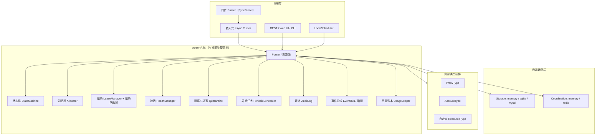

# 架构

## 分层



## 存储层 × 协调层

| 平面 | 实现 | 保存内容 | 丢失后果 |
| --- | --- | --- | --- |
| 存储层 | `memory` / `sqlite` / `mysql` | 资源主数据、重要状态、槽位计数、`version` CAS、审计 | 业务事故，必须持久化 |
| 协调层 | `memory` / `redis` | 在途租约、心跳、等待唤醒、校验缓存 | 单实例可对账重建；多实例丢失可能重复占用，详见[数据平面](data-planes.md) |

两个平面独立取值，行为测试按 存储 × 协调 的笛卡尔积运行。关键约束：

- 写路径带版本 CAS，跨实例防丢更新（`VersionConflict`）。
- 协调端断连 fail-closed，抛 `BackendUnavailable`，不静默降级。
- 迟到 release（token 已不在协调端）绝不触碰存储槽位，避免误扣新持有者。
- 重启后 `start()` 按协调端**当前存活租约之和**对齐槽位，支持全孤儿与部分孤儿收敛。

## 核心概念

| 概念 | 说明 |
| --- | --- |
| `Resource` | 一条资源（代理/账号/自定义对象），携带状态、健康分、租约、配额 |
| `ResourceType` | 类型插件：`generate` / `validate` / 请求级钩子 |
| `Pool` | 一个类型 + 一套配置对应的资源集合 |
| `Lease` | 一次租约：token + TTL + 心跳 + 槽位数 |
| `StorageBackend` | 存储层接口 |
| `Coordination` | 协调层接口 |
| `EventBus` | 有界队列异步分发，慢订阅者丢弃 + 背压告警 |
| `AuditLog` | append-only 审计 + SHA-256 哈希链 |
| `UsageLedger` | 进程内有界用量明细，驱动报表 |

## 运行形态

| 形态 | 存储 | 协调 | 适用 |
| --- | --- | --- | --- |
| 嵌入式单进程 | `memory` | `memory` | 单采集任务、本地开发、测试 |
| 嵌入式持久化 | `sqlite` | `memory` | 单机重启不丢，仍只有一个调度进程 |
| 独立服务单实例 | `sqlite` / `mysql` | `memory` | REST + UI + CLI |
| 多实例服务 | `sqlite` / `mysql` | `redis` | 团队共享资源池、横向扩容 |

`SyncPurser` 独占一个事件循环线程，把 async 内核包装成阻塞 API；适合同步代码或线程池环境，但实例不可跨进程共享，也不可 pickle（`IsolationConflict`）。

## 代码目录

```text
purser/
  __init__.py            # 公共导出
  facade.py              # Purser / 资源池的编排
  config.py              # PoolConfig / Weights
  sync.py                # SyncPurser / SyncPool / SyncLease
  authority.py           # 进程内权威/单例约束
  binding.py             # worker 绑定
  isolation.py           # 跨进程共享与 pickle 防护
  idempotency.py         # 幂等键存储
  crypto.py              # AES-GCM 敏感字段加密
  metrics.py             # 计数器/直方图
  core/
    state.py             # ResourceState + 转移表
    resource.py          # Resource / PayloadField / Lease / AcquireRequest
    allocator.py         # 分配器协议与内置策略
    lease.py             # LeaseManager / 租约回收器
    health.py            # HealthReport / 验活调度
    quarantine.py        # 退避策略
    scheduler.py         # 周期任务
    audit.py             # 哈希链审计
    events.py            # EventBus
    usage.py             # 用量账本
    views.py             # 报表 TypedDict
  backends/
    base.py              # StorageBackend / Coordination 协议
    memory.py            # 内存存储
    sqlite.py            # SQLite 存储 + 版本 CAS
    mysql.py             # MySQL 存储
    coordination.py      # Memory / Redis 协调
    serde.py             # 资源序列化
  types/
    base.py              # ResourceType 基类与注册表
    proxy.py             # 代理类型
    account.py           # 账号类型
  local/
    protocol.py          # 本地调度协议
    server.py            # 本地调度服务
    client.py            # 本地调度客户端
    scheduler.py         # LocalScheduler
  ui/
    server.py            # FastAPI 应用与路由
    static/              # 单页控制台
  cli.py                 # rich CLI
```

## 实现范围

- **M0 内核**：状态机、分配器、租约、公平队列、事件、审计。
- **M1 插件与验活**：请求级按站校验、配额/计量、冷却、导入去重、payload 加密、幂等、trace 事件。
- **M2 分布式**：Redis + Lua CAS + hash tag + fail-closed、重启对账。
- **M3 操作台**：REST + Web UI + CLI + 健康探针 + 指标。
- **持久化**：SQLite / MySQL 存储、审计落库、备份恢复。
- **同步 Purser**：独立事件循环线程、回调线程池、跨进程隔离。

P2/P3 项（组合租约 bundle、配置门控自动抢占、blue-green 迁移、事件游标增强等）按设计文档预留，未进入首版。
