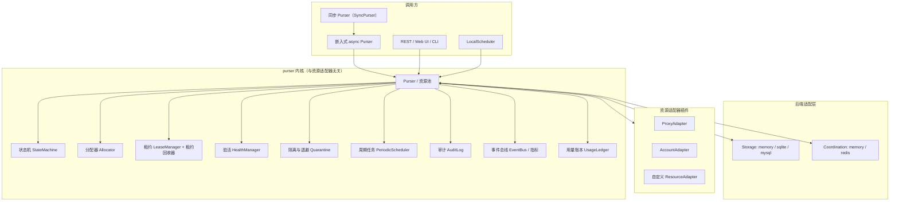

# 架构

本页描述分层、模块边界与运行形态；不变量与算法见[算法与不变量](algorithms.md)，两个平面的丢失语义见[数据平面](data-planes.md)。

## 分层

## 存储层 × 协调层

两个平面独立取值：**存储层**（`memory` / `sqlite` / `mysql`）保存资源主数据、状态、槽位计数、`version` CAS 与审计，丢失即业务事故；**协调层**（`memory` / `redis`）保存在途租约、心跳与唤醒，单实例可对账重建、多实例丢失可能重复占用。职责边界、丢失等级与选型见[数据平面与丢失语义](data-planes.md)。

关键约束：

- 写路径带版本 CAS，跨实例防丢更新（`VersionConflict`）。
- 协调端断连 fail-closed，抛 `BackendUnavailable`，不静默降级。
- 迟到 release（token 已不在协调端）绝不触碰存储槽位，避免误扣新持有者。
- 重启后 `start()` 按协调端**当前存活租约之和**对齐槽位，支持全孤儿与部分孤儿收敛。

## 核心概念

| 概念 | 说明 |
| --- | --- |
| `Resource` | 一条资源（代理/账号/自定义对象），携带状态、健康分、租约、配额 |
| `ResourceAdapter` | 适配器插件：`generate` / `validate` / 请求级钩子 |
| `Pool` | 一个类型 + 一套配置对应的资源集合 |
| `Lease` | 一次租约：token + TTL + 心跳 + 槽位数 |
| `StorageBackend` | 存储层接口 |
| `Coordination` | 协调层接口 |
| `EventBus` | 有界队列异步分发，慢订阅者丢弃 + 背压告警 |
| `AuditLog` | append-only 审计 + SHA-256 哈希链 |
| `UsageLedger` | 进程内有界用量明细，驱动报表 |

## 运行形态

| 形态 | 存储 | 协调 | 适用 |
| --- | --- | --- | --- |
| 嵌入式单进程 | `memory` | `memory` | 单采集任务、本地开发、测试 |
| 嵌入式持久化 | `sqlite` | `memory` | 单机重启不丢，仍只有一个调度进程 |
| 独立服务单实例 | `sqlite` / `mysql` | `memory` | REST + UI + CLI |
| 多实例服务 | `sqlite` / `mysql` | `redis` | 团队共享资源池、横向扩容 |

`SyncPurser` 独占一个事件循环线程，把 async 内核包装成阻塞 API；适合同步代码或线程池环境，但实例不可跨进程共享，也不可 pickle（`IsolationConflict`）。

## 代码组织

- `facade/`：`Purser` 组合根与共享 helper；`pool/`：`ResourcePool` 数据面与管理面。
- `core/`：状态机、分配器、租约、验活、隔离、事件、审计、用量账本。
- `backends/`：存储与协调实现；`adapters/`：资源插件；`local/`：同机 IPC 调度。
- `config.py` 与 `config_schema.py`：`PoolConfig`、字段 schema 与场景预设。

目录树与逐文件说明见[贡献指南](../contributing/index.md)。里程碑与 P2/P3 预留项记录在归档的 `docs/design/design-doc.md`（不发布到站点）。
