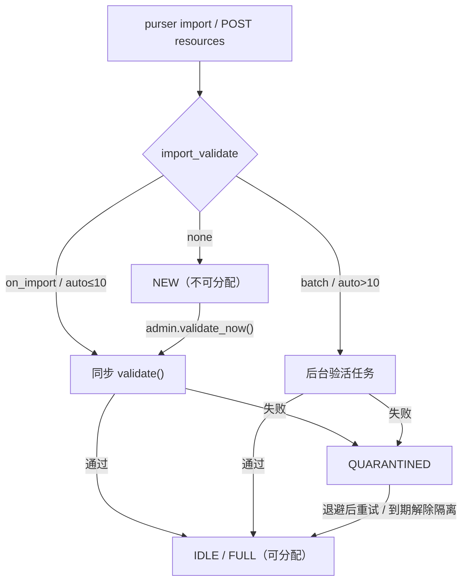

# 导入与验活

导入决定资源“从哪来”，验活决定资源“能否被分配”。两者的边界是 `import_validate` 的取值。

## 导入策略

| 值 | 行为 | 资源进入可分配状态 |
| --- | --- | --- |
| `auto`（默认） | ≤10 条同步验活；更多记录交给后台验活任务 | 同步部分通过后立即 `IDLE`；后台部分任务完成后依次 `IDLE` |
| `none` | 只入库，停在 `NEW` | 否，需显式验活 |
| `on_import` | 逐条同步验活，结果写入报告 | 通过后进入 `IDLE` |
| `batch` | 交给后台验活任务，立即返回 | 任务完成后依次进入 `IDLE` |

省略时取池配置 `import_validate`（默认 `auto`）：小批量导入在返回时即已验活可用，大批量导入立即返回、由后台任务验活；首次 `acquire()` 在资源未就绪时会等待（最长到请求的 `timeout` / 池的 `wait_timeout`）。要固定行为时显式传 `on_import`（必须“导入即可用”，大批量会很慢）或 `batch`（导入快、可用性稍后达成）。



## NEW 不可分配

`NEW` 不会被周期性维护任务自动推进；它只会在默认 `auto`（或显式 `batch` / `on_import`）或手动 `admin.validate_now()` 时进入验活流程。默认导入会立即创建验活流程（小批量同步、大批量后台任务），因此资源通常很快变为 `IDLE`；`acquire()` 在资源处于 `NEW`/`VALIDATING` 时会等待验活完成，直到请求超时。

只有显式使用 `import_validate="none"` 时，资源才会长期停在 `NEW`。此时池内资源全部为 `NEW` 且没有进行中的验活任务，`acquire()` 会立即抛出带操作的 `PoolExhausted`，而不是空等到 `wait_timeout`。推进方式：

```python
await pool.admin.validate_now(rid="r1", operator="alice")
```

或用 `on_import` / `batch` 重新导入。除非确实要离线预装数据，否则保持默认的 `auto`。

## 嵌入式导入

```python
report = await pool.import_resources(
    records=[
        {"id": "r1", "host": "1.2.3.4", "port": 8080, "tags": ["http"]},
        {"id": "r2", "host": "5.6.7.8", "port": 3128, "tags": ["http"]},
    ],
    dedup_key="id",
    source="manual",
    operator="alice",
    fail_fast=False,
    import_validate="on_import",
)

print(report.imported, report.updated, report.skipped, report.total)
print(report.errors)
print(report.batch_id)
print(report.validation)   # 同步验活的逐条结果（on_import / auto 小批量）
```

`ImportReport` 字段：

| 字段 | 说明 |
| --- | --- |
| `imported` / `updated` / `skipped` | 新增 / 覆盖更新 / 去重跳过 |
| `errors` | 逐条失败：`{line, error}`，部分路径额外带 `id`；`line` 是记录在本次输入中的下标 |
| `validation` | 同步验活（`on_import` / `auto` ≤10 条）的 `id / alive / latency_ms / error / action` |
| `batch_id` | `batch` 模式的后台任务 id |
| `total` | `imported + updated + skipped + len(errors)`，包含失败行 |

`fail_fast=True` 遇到首条错误即中断；默认逐条继续，单条失败不阻断整批。

## 去重与幂等

- `dedup_key` 默认 `"id"`；同键资源视为同一条，导入会更新而非新增。
- 需要“同一批重复提交复用首次结果”时，在 REST/CLI 层使用 `Idempotency-Key` / `--idempotency-key`。
- 后台验活任务按 `batch_id` 查询，不在 `report.validation` 中。

## 验活语义

- 验活结果由 `ResourceAdapter.validate()` 返回 `HealthReport`；失败进入 `QUARANTINED`，连续失败升级 `BANNED`。
- 命名检查项（`@validator`）先于 `validate()` 自动执行：`both=True` 的检查项失败与验活失败同流程（`QUARANTINED` / 连续失败升 `BANNED`）；`both=False` 的检查项只按名手动触发，不改状态。详见[自定义资源适配器](custom-resource-adapter.md)。
- 请求级校验（`on_request_check`）发生在获取路径，按目标站拒绝不合适的候选；它与导入验活是两条独立路径。
- 验活并发度由 `validate_workers` 控制；后台任务 worker 数取 `min(validate_workers, 本批资源数)`。

## CLI 文本格式

`purser import` 每行支持：

```text
host port
id host port
id protocol host port tag1 tag2
```

`#` 开头为注释；行首为 `[` 的单行 JSON 数组可直接导入。

继续阅读：[Reports](../reference/rest-api/reports.md)、[状态机](../reference/state-machine.md)。
