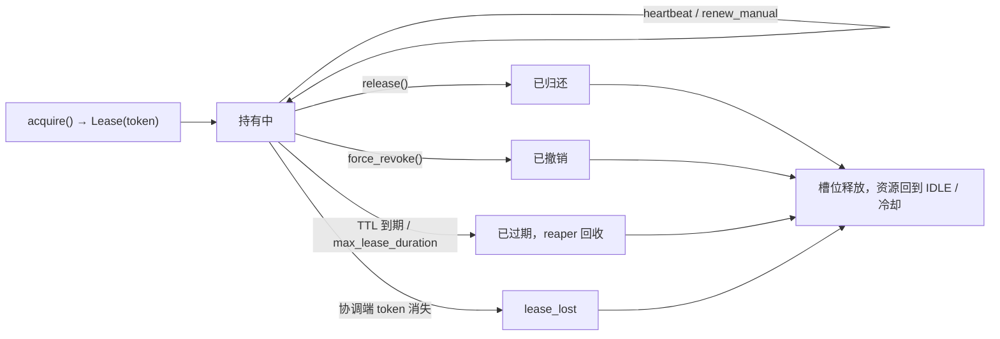

# 租约生命周期

租约是资源使用的唯一凭据：`token` 标识一次获取，TTL 与心跳保证异常退出后资源能回到池里。



## 启动前提

`acquire()` / `lease()` / `acquire_many()` 要求运行时已启动：

```python
async with Purser() as ps:      # start() + close()
    ...
```

或在导入之后显式启动：

```python
ps = Purser()
pool = ps.create_pool("proxies", "proxy")
await pool.import_resources(records, import_validate="on_import")
await ps.start()
...
await ps.close()
```

未启动时调用会抛 `NotStarted`，消息里带修复提示。导入、查询、状态变更等管理面操作在 `start()` 之前仍可用。

## 推荐路径：上下文管理器

```python
from purser import AcquireRequest, UsageOutcome

async with pool.lease(AcquireRequest(consumer="crawler-a", tags=["http"])) as lease:
    try:
        await fetch(lease.payload)
        lease.outcome = UsageOutcome.OK
    except TimeoutError:
        lease.outcome = UsageOutcome.TIMEOUT
```

退出时自动按 `lease.outcome` 归还。`lease.resource` 是 acquire 时加载的类型化快照；需要最新状态或租约由其他进程重建时，用 `await pool.require(lease.resource_id)`。

## 手动路径

```python
lease = await pool.acquire(AcquireRequest(consumer="crawler-b"))
try:
    ...
finally:
    await pool.release(lease, outcome=UsageOutcome.OK, used=1)
```

- 归还必须 token 匹配，否则 `LeaseConflict`。
- 迟到归还（token 已不在协调端）幂等返回 `True`，不会误扣新持有者的槽位。
- `used` 是本次实际使用次数，进入用量报表；不传时按租约累计值或 1 计。

## 批量获取

```python
batch = await pool.acquire_many(5, req=req, mode="atomic")
try:
    for lease in batch.leases:
        ...
finally:
    await batch.release_all(pool)
```

- `atomic`：任一项不足则整体回滚。
- `best_effort`：按实际可用数量返回，低于 `n_min` 抛 `PoolExhausted`。
- 异步 `release_all(pool, outcome=UsageOutcome.OK)` 必须传池；同步 Purser 的 `SyncBatchLease.release_all(outcome)` 不需要。

## 定向获取

```python
lease = await pool.acquire(AcquireRequest(resource_id="r42", timeout=5))
```

资源被占用时按 `timeout` 等待，超时抛 `ResourceBusy`。

## 续约与寿命

- 默认 `lease_ttl=60s`，心跳按 TTL/3 自动续约。
- `await pool.renew_manual(lease)` 用于长任务显式保活；被拒返回 `False`。
- `max_lease_duration` 到达后拒续，心跳停跳，reaper 回收；租约使用超限抛 `LeaseLimitReached`。
- 续约被后端拒绝会触发 `lease_lost` 事件；持有者继续使用会得到 `LeaseLostError` / `LeaseExpired`。

## 强制撤销与失联

```python
# 不带 token：只撤销该资源的任意一条租约（并发资源可能仍有其它租约）
await pool.force_revoke("r42", operator="alice", reason="credential leak")

# 带 token：精确撤销指定租约
await pool.force_revoke("r42", operator="alice", reason="single lease", token="l_...")

# 需要撤销该资源的全部租约时，由调用方遍历当前租约，并容忍并发归还
for lease in list(await pool.leases("r42")):
    try:
        await pool.force_revoke(
            "r42", operator="alice", reason="credential leak", token=lease.token
        )
    except LeaseConflict:
        pass  # 已被并发归还或回收
```

- 每次调用只处理**一条**租约；`token` 只是用来指定是哪一条，不会扩大范围。
- 强制撤销写入审计并发布 `lease_revoked` 事件，返回被撤销的 `Lease`；原持有者后续调用会收到 `LeaseRevokedError`。
- 被撤销租约的 `consumer` 在该资源上进入 10 秒消费者级冷却（`meta["cooldown:<consumer>"]`），其他消费者不受影响；匿名租约没有消费者冷却。
- `lease_lost` 事件（心跳被拒/协调端 token 消失）只回收槽位并发出事件，不会把资源转成 `LOST`。`LOST` 是保留的失联状态，当前没有自动进入路径，见[状态机](../reference/state-machine.md)。

## 常见错误

| 异常 | 场景 |
| --- | --- |
| `NotStarted` | 池未启动 |
| `PoolEmpty` | 池内没有资源，立即失败 |
| `PoolExhausted` | 等待超时；池内资源全部为 `NEW` 时也会立即抛出 |
| `ResourceBusy` | 定向获取超时 |
| `LeaseConflict` | token 不匹配或并发状态冲突 |
| `LeaseExpired` / `LeaseLostError` | 租约已过期或在持有期间丢失 |
| `LeaseRevokedError` | 被管理员强制撤销 |

同步代码见 [同步 Purser](sync-facade.md)。
