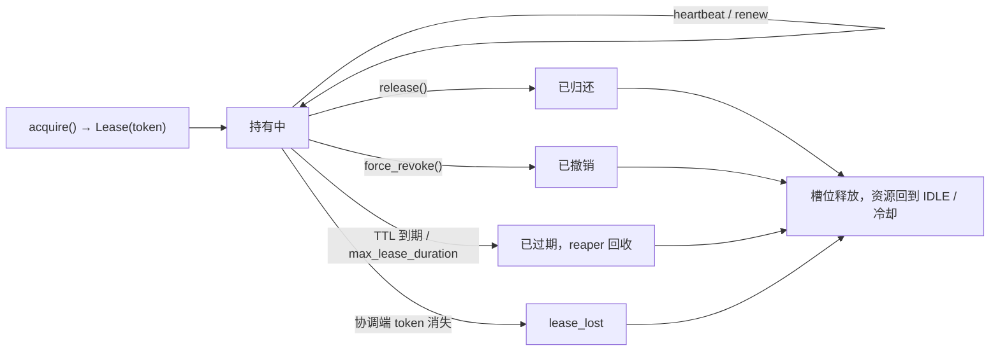

# 租约生命周期

租约是资源使用的唯一凭据：`token` 标识一次获取，TTL 与心跳保证异常退出后资源能回到池里。



## 运行时启动

`acquire()` / `lease()` / `acquire_many()` 首次调用会自动启动运行时（也会自动启动 Purser），不再要求先 `await ps.start()`。`async with Purser() as ps:` 仍推荐使用——它负责提前启动并确保退出时清理：

```python
async with Purser() as ps:      # 可选：提前启动 + 退出时 close()
    ...
```

如需先离线导入再使用，也可以显式启动：

```python
ps = Purser()
pool = ps.create_pool("proxies", "proxy")
await pool.import_resources(records, import_validate="on_import")
await ps.start()                # 可选：提前启动（幂等）
...
await ps.close()
```

`ps.close()` 之后再调用运行时操作会抛 `NotStarted`（已关闭，不支持重启），消息里带修复提示。导入、查询、状态变更等管理面操作无需启动即可用。

## 推荐路径：上下文管理器

```python
from purser import AcquireRequest, UsageOutcome

async with pool.lease(AcquireRequest(consumer="crawler-a", tags=["http"])) as lease:
    try:
        await fetch(lease.payload)
        lease.outcome = UsageOutcome.OK
    except TimeoutError:
        lease.outcome = UsageOutcome.TIMEOUT
```

退出时自动按 `lease.outcome` 归还。`lease.resource` 是 acquire 时加载的类型化快照；需要最新状态或租约由其他进程重建时，用 `await pool.require(lease.resource_id)`。

块内抛异常时仍按 `lease.outcome` 归还，默认是 `UsageOutcome.OK`——消费者异常不自动等同于资源故障。若异常本身说明资源不可用，请在 `except` 中显式设置 `lease.outcome = UsageOutcome.TIMEOUT / NETWORK_ERROR / BANNED`，或改用手动路径自定义 `release(outcome=...)`。

## 手动路径

```python
lease = await pool.acquire(AcquireRequest(consumer="crawler-b"))
try:
    ...
finally:
    await pool.release(lease, outcome=UsageOutcome.OK, used=1)
```

- 归还必须 token 匹配，否则 `LeaseConflict`。
- 迟到归还（token 已不在协调端）幂等返回 `True`，不会误扣新持有者的槽位。
- `used` 是本次实际使用次数，进入用量报表；不传时按租约累计值或 1 计。

## 无占用取样（`acquire_mode="stateless"`）

只需要“拿一份资源、不归还、不占并发”的脚本可以整池切换模式，调用面保持不变：

```python
pool = ps.create_pool("proxies", "proxy", acquire_mode="stateless", allocator="random")
proxy = await pool.acquire()        # 仍返回 Lease，但不注册租约、不占槽位
```

- 同一资源可以被无限次取样；`pool.leases()` 为空，`concurrency` 不变。
- 容量、消费者持有、互斥组过滤被跳过；状态、标签、时间窗、冷却、站点失败与配额仍然生效。
- `release()` 变为可选：显式调用只反馈用量/健康（`used`、`outcome`、冷却、隔离）并发布事件，重复调用是安全的 no-op。
- 取样得到的租约不参与心跳续期、`max_lease_duration` 与抢占。

## 批量获取

```python
batch = await pool.acquire_many(5, req=req, mode="atomic")
try:
    for lease in batch.leases:
        ...
finally:
    await batch.release_all(pool)
```

- `atomic`：任一项不足则整体回滚。
- `best_effort`：按实际可用数量返回，低于 `n_min` 抛 `PoolExhausted`。
- 异步 `release_all(pool, outcome=UsageOutcome.OK)` 必须传池；同步 Purser 的 `SyncBatchLease.release_all(outcome)` 不需要。

## 定向获取

```python
lease = await pool.acquire(AcquireRequest(resource_id="r42", timeout=5))
```

资源被占用时按 `timeout` 等待，超时抛 `ResourceBusy`。

## 续约与寿命

- 默认 `lease_ttl=60s`，心跳按 TTL/3 自动续约。
- `await pool.renew(lease)` 用于长任务显式保活；成功返回新的 `expires_at`（`float`）。
- `use_limit` 在续约时校验租约上的 `used`。跨进程续约会携带 `RemoteLease.used`，调度进程只按最大值更新，因此重试和乱序上报不会把计数改小；要尽早拦截，消费后主动续约一次即可。
- 续约被拒抛异常：`use_limit` 或 `max_lease_duration` 用尽抛 `LeaseLimitReached`，协调端已不认识 token 抛 `LeaseLost`。
- 心跳续约遇到同样的拒绝会停止续约并回收槽位，同时触发 `lease_lost` 事件；持有者继续使用会得到 `LeaseLost` / `LeaseExpired`。

## 强制撤销与失联

```python
# 不带 token：只撤销该资源的任意一条租约（并发资源可能仍有其它租约）
await pool.admin.force_revoke("r42", operator="alice", reason="credential leak")

# 带 token：精确撤销指定租约
await pool.admin.force_revoke("r42", operator="alice", reason="single lease", token="l_...")

# 需要撤销该资源的全部租约时，由调用方遍历当前租约，并容忍并发归还
for lease in list(await pool.leases("r42")):
    try:
        await pool.admin.force_revoke(
            "r42", operator="alice", reason="credential leak", token=lease.token
        )
    except LeaseConflict:
        pass  # 已被并发归还或回收
```

- 每次调用只处理**一条**租约；`token` 只是用来指定是哪一条，不会扩大范围。
- 强制撤销写入审计并发布 `lease_revoked` 事件，返回被撤销的 `Lease`；原持有者后续调用会收到 `LeaseRevoked`。
- 被撤销租约的 `consumer` 在该资源上进入 10 秒消费者级冷却（`meta["cooldown:<consumer>"]`），其他消费者不受影响；匿名租约没有消费者冷却。
- `lease_lost` 事件（心跳被拒/协调端 token 消失）只回收槽位并发出事件，不会把资源转成 `LOST`。`LOST` 是保留的失联状态，当前没有自动进入路径，见[状态机](../reference/state-machine.md)。

## 常见错误

| 异常 | 场景 |
| --- | --- |
| `NotStarted` | 运行时已 `close()`，不支持重启 |
| `PoolEmpty` | 池内没有资源，立即失败 |
| `PoolExhausted` | 等待超时；资源停在 `NEW` 且无验活任务时也会立即抛出（`VALIDATING` 期间会等待） |
| `ResourceBusy` | 定向获取超时 |
| `LeaseConflict` | token 不匹配或并发状态冲突 |
| `LeaseExpired` / `LeaseLost` | 租约已过期或在持有期间丢失 |
| `LeaseRevoked` | 被管理员强制撤销 |

同步代码见 [同步 Purser](sync-facade.md)。
