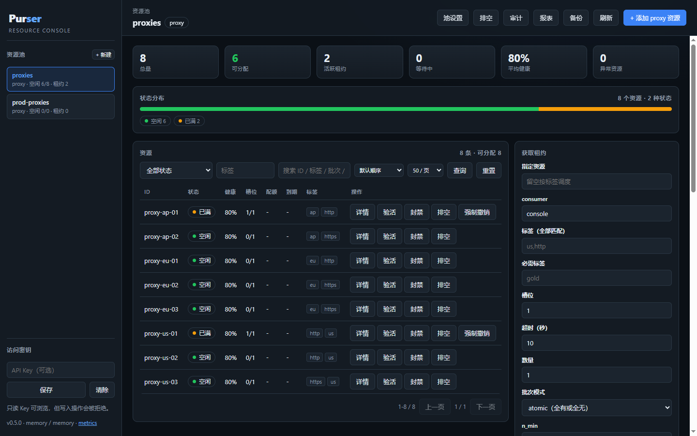
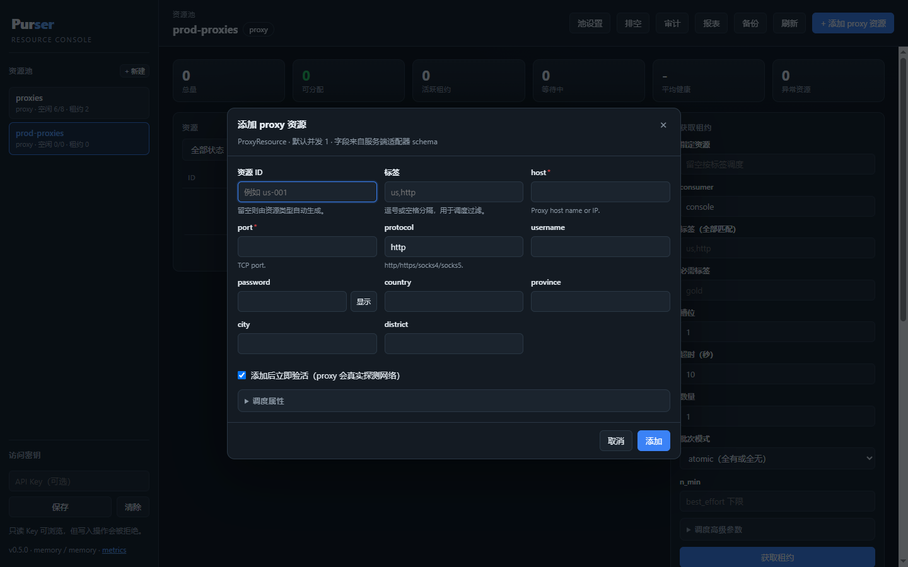
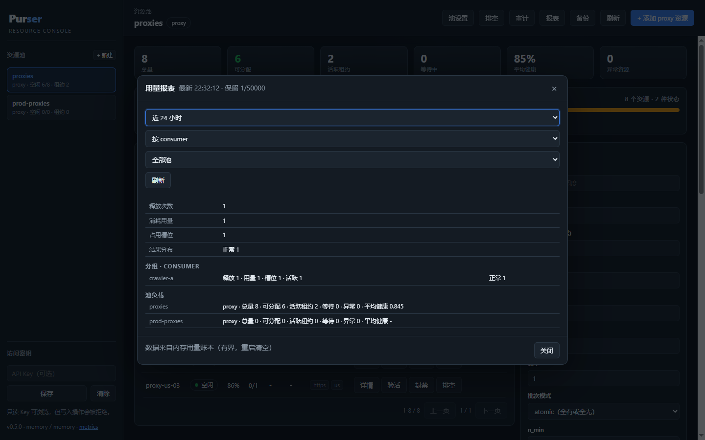

# Web 控制台

`purser serve` 自带 Web 控制台，覆盖建池、加资源、获取/归还租约、验活、审计、报表与备份。控制台与 CLI、REST 共用同一套 API，不是另一条写入路径；自动化任务仍建议直接调用 REST。

<div class="screenshot">
  
</div>

## 打开与鉴权

```bash
purser serve --host 0.0.0.0 --port 8000
```

浏览器打开 `http://127.0.0.1:8000/`。左栏底部的 **访问密钥** 用于填写 `PURSER_API_KEY` 或 `PURSER_READONLY_KEY`：

- 密钥保存在浏览器 `localStorage`，刷新后仍在；**清除** 只删除本地副本。
- 只读 Key 可以浏览全部面板，但添加、排空、撤销等写操作会被服务端拒绝。
- 左栏底部同时显示当前 `storage · coordination · metrics` 组合，排障时先确认它是否符合预期。

!!! warning "不配密钥等于完全开放"

    同时未设置 `PURSER_API_KEY` 与 `PURSER_READONLY_KEY` 时，服务按匿名 admin 处理，任何能访问端口的人都能下载包含明文密钥的备份。对公网或共享网络暴露前，务必配置密钥或加反向代理鉴权。见 [配置参考](../reference/configuration.md)。

## 界面分区

| 区域 | 内容 |
| --- | --- |
| 左栏 | 资源池列表、新建资源池、访问密钥、服务信息 |
| 顶栏 | 池设置、排空、审计、报表、备份、刷新、添加资源 |
| KPI | 总量、可分配、活跃租约、等待中、平均健康、异常资源 |
| 状态分布 | 按 12 个状态统计的色条，鼠标悬停查看状态与数量 |
| 资源表 | 状态/标签/关键词筛选、健康分与最近使用排序、分页与行内操作 |
| 右栏 | 获取租约、活跃租约、导入批次、SSE 事件流、指标快照 |

资源表的行内操作：

- **详情**：查看字段、调度属性、活跃租约与健康样本，可编辑普通字段。
- **验活**：同步探测一次，结果写入事件流与健康分。
- **封禁 / 解封**：封禁后不参与分配，解封时间由 `unban_after` 与 `unban_mode` 决定。
- **排空 / 撤销排空**：排空只停止新分配，存量租约归还后归档。
- **强制撤销**：撤销该资源的一条在途租约；资源仍被其他租约占用时可再次点击。用于事故处置。
- **恢复**：仅归档资源显示，恢复后会立即验活。

## 建池与改配置

新建资源池时池名与**资源类型**必填，其余都可以留空。适配器决定资源表单字段，创建后不可修改。

“场景预设 profile（仅创建时）”是可选起点（`basic` / `validated` / `shared` / `long_running` / `quota` / `random` / `one_shot`），基础脚本不需要选择。预设与显式字段冲突时，显式字段覆盖预设。

“调度与运行参数”由 `GET /config/schema` 动态生成，覆盖部署、分配、租约、隔离、验活与保留等全部池配置。`storage`、`coordination`、`secret_fields`、`event_queue_size`、`schema_version` 只能在建池时指定，编辑时会锁定；其余字段可在 **池设置** 中热更新。多实例部署应选 `sqlite`/`mysql` + `redis`。

编辑池时，留空表示保持原值；可空字段勾选“清除”才置空。布尔字段是三态控件，未选择时不会覆盖 profile 或原值。弹窗字段直接来自服务端 schema，占位符只是默认值提示；完整字段、预设与热更新限制见 [配置参考](../reference/configuration.md)。

## 添加资源

<div class="screenshot">
  
</div>

资源表单由服务端适配器 `schema` 生成：`required` 字段标红星，`secret` 字段默认掩码并可点“显示”；自定义适配器注册了什么字段，这里就出现什么字段。

“调度属性”可覆盖单条资源的 `max_slots`、`usage_quota`、`quota_limit`、`expires_at`、`next_available_at`、`mutex_group`、可用时段、`priority` 与 `preference`；`priority` 供 `static_priority` 分配器使用，`preference` 是偏好加分。编辑资源时同样可修改这两项并显式清除。“自定义字段 JSON”合并进资源载荷，已由表单填写的键以表单为准。

默认勾选 **添加后立即验活**。对 `proxy` 类型会发起真实网络探测；导入大量资源并开启验活前，先确认出口网络可用，否则会成批进入隔离。

控制台只做单条添加；批量导入用 `purser import` 或 `POST /pools/{pool}/resources`，导入与验活规则见[导入与验活](import-and-validate.md)。

## 获取与归还租约

右栏“获取租约”支持标签调度、指定资源、`consumer`、必需标签、槽位、超时与数量。一次取多个时：

- `atomic`：全部成功才返回，否则整体失败；
- `best_effort`：凑够 `n_min` 即返回，余下的尽力补齐。

高级参数包括 `priority`、`use_limit`、`probe`、`trace_id`、目标站点、`Idempotency-Key`、`allow_duplicate` 与 `ignore_cooldown`。字段含义与冲突规则见 [租约生命周期](lease-lifecycle.md)。

“活跃租约”可按 `consumer` 或资源 ID 过滤，单条归还时选择结果（正常、验证码、限流、被封、超时等）并填写 `used`；“按 consumer 归还”会一次释放该调用方的全部租约。归还结果直接影响健康度、隔离与配额，见 [公平性与健康度](fairness-and-health.md)。

## 观察、审计与报表

- **事件流**：未配置密钥时订阅当前池的 SSE，连接失败会自动回退到历史轮询；配置密钥后 `EventSource` 无法携带 `Authorization`，控制台直接从 `/events/history` 轮询。可按 `type` 或资源 ID 过滤，支持暂停与清空。
- **指标**：展示 `/metrics/snapshot` 的计数器与直方图，用于快速定位分配失败、验活失败与延迟分布。
- **审计**：“校验链”调用 `/audit/verify` 验证 append-only 哈希链；可按池、动作、资源、操作者过滤并向前翻页。
- **报表**：按 1 小时 / 24 小时 / 7 天 / 全部保留统计，可按 `consumer`、目标站、池或类型分组。

<div class="screenshot">
  
</div>

报表来自有界内存账本，重启即清空；需要长期留存时定时拉取 `/reports/usage` 落库，具体字段见 [Reports](../reference/rest-api/reports.md)。

**备份 / 恢复** 弹窗可下载全量 JSON 或上传恢复：备份包含明文密钥，只应保存在受控位置（见[安全模型](../guides/security.md#backup)）；恢复不迁移在途租约，占用态资源会回到空闲；`skip` / `overwrite` 决定同名池的处理方式。

## 与控制台之外的分工

| 场景 | 建议入口 |
| --- | --- |
| 临时加一条资源、看状态、手动归还 | Web 控制台 |
| 批量导入、定时任务、自动化脚本 | CLI 或 REST |
| 多实例部署与存储/协调配置 | 启动参数或环境变量，见[多实例部署](multi-instance.md) |
| 强制操作与审计追溯 | 控制台或 `/audit`，见[运维操作](operations.md) |

控制台不替代监控：进程健康、就绪与存储/协调状态仍应通过 `/healthz`、`/readyz`、`/service` 接入现有告警体系。

相关页面：[运维操作](operations.md)、[可观测性](observability.md)、[安全模型](security.md)、[生产检查清单](production-checklist.md)。
