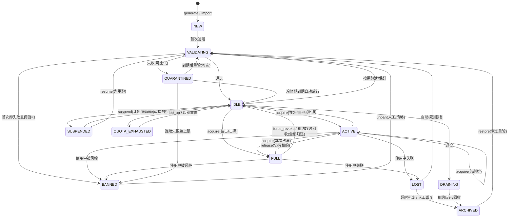
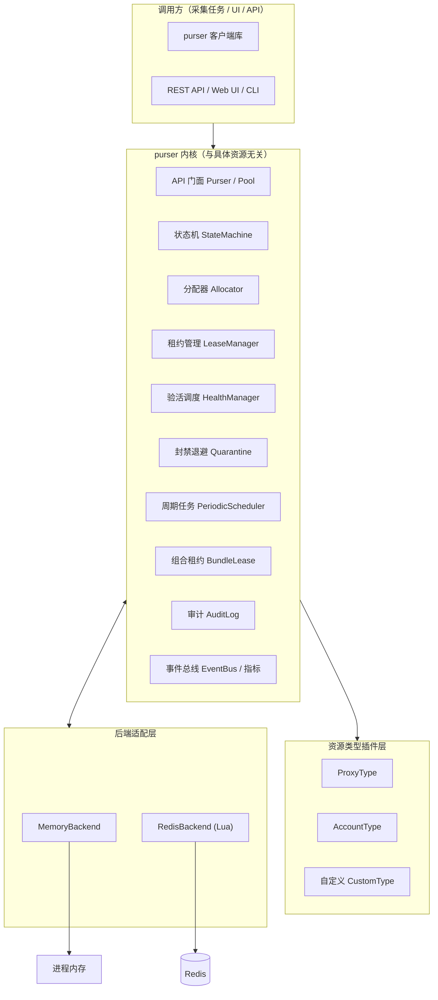

# purSer 设计文档 —— 通用采集资源调度库

> 版本：v0.1（设计草案）
> 日期：2026-11-05
> 状态：83 项能力已确认并按 P0-P3 分级排布（见第 9/14 章），待补齐 API 契约后开始 M0（P0 内核）实现
> 定位：面向采集场景的**通用资源调度库**，统一管理代理、账号、自定义采集资源在全生命周期内的生成、验活、获取、回收、封禁与解封。

---

## 0. 命名与一句话定位

`purSer`（purser，事务长 / 财务官，兼取 purse 钱包之意）：

> **把每种可复用资源当作“钱包里的钱”，按状态、健康度、配额与公平性规则安全地借出（lease）、验真（validate）、冻结（ban）与归还（release）。**

设计三原则：
- **通用内核 + 类型插件**：内核只关心状态机、调度、租约与后端一致性；代理/账号等差异全部收敛到 `ResourceType` 插件。
- **异步优先**：全链路 `asyncio`，与采集任务天然配套，单事件循环内零锁竞争。
- **后端可插拔**：默认内存后端开箱即用，Redis 后端提供多实例共享与跨进程原子性，业务代码无感切换。

---

## 1. 背景与目标

### 1.1 要解决的问题

采集系统普遍面临“资源运维”散落各处的痛点：

1. 代理要测速、验活、按地区/协议筛选、防封、轮换；
2. 账号要登录态保鲜、并发会话限额、风控封禁、自动解封；
3. 每套采集程序都在重复造轮子：手写状态字典、手写超时清理、手写互斥。

`purSer` 的目标是提供一套**与具体资源无关的调度内核**：

- 统一的资源生命周期：`生成 → 验活 → 获取 → 使用 → 回收`，外加 `封禁/解封/隔离/失联/退役`。
- 统一的并发语义：独占（一个连接只能用一次）、并发（一个账号可开 N 会话）、按容量计数。
- 统一的运维入口：内存或 Redis 双后端 + Web UI / CLI / REST API。
- 顶尖的分配算法：健康加权、LRU 轮替、配额公平、防惊群、租约心跳与看门狗回收。

### 1.2 非目标（边界）

- 不做采集逻辑本身（不实现爬虫、验证码识别、指纹伪装）；
- 不做分布式任务编排（不抢 Spark/Airflow 的活，只做资源层）；
- 不做账号风控策略推断（只按你给的校验结果和规则执行状态迁移）。

---

## 2. 可行性分析

### 2.1 需求拆解

| 需求 | 可落地性 | 说明 |
| --- | --- | --- |
| 资源类型可扩展（代理/账号/自定义） | 高 | Python ABC + 注册表即可，插件式声明式模型 |
| 生命周期与多状态 | 高 | 经典有限状态机，状态转移表驱动，天然可测 |
| 独占/并发/封禁/解封 | 高 | 租约 + 容量计数 + 隔离退避，算法成熟 |
| 内存/Redis 双后端 | 高 | redis-py + Lua 脚本保证跨进程原子性 |
| Web UI | 高 | FastAPI + 单页静态页，无构建链 |
| Python 实现、代码优雅 | 高 | asyncio + dataclass + Protocol + 事件驱动 |

### 2.2 关键技术难点与对策

| 难点 | 风险 | 对策 |
| --- | --- | --- |
| 验活成本高（代理/账号探测耗时） | 获取延迟、后台扫描风暴 | 自适应验活调度 + 按需验活 + EWMA 健康分 |
| 分布式状态漂移 | 两个实例同时获得同一资源 | Redis Lua 原子 CAS + 版本号乐观锁 |
| 租约泄漏（进程崩溃、忘记归还） | 资源永久丢失 | 租约 TTL + 心跳续约 + 看门狗 reaper |
| 封禁误伤 | 账号被风控永久废掉 | 先隔离后封禁 + 处罚梯度 + 试用期保护 |
| 资源饥饿/抢同质资源 | 单点热点、抖动 | 分批候选 + 加权随机 + 公平等待队列 |
| 过度泛化 | 内核变成四不像 | 内核只做状态机/调度/租约，差异全在插件 |

### 2.3 结论

**可行，且风险可控。** 建议按 M0→M3 分四阶段落地：

- M0：纯内存内核 + 生命周期 + 单测，先跑通“模型正确”；
- M1：验活插件（代理/账号）+ 封禁退避 + 事件；
- M2：Redis 后端 + Lua 原子性 + 多实例；
- M3：Web UI / CLI / 指标。

---

## 3. 领域模型

### 3.1 核心概念

| 概念 | 说明 |
| --- | --- |
| `Resource` | 一条资源：代理、账号或自定义对象，携带状态与元数据 |
| `ResourceType` | 资源类型插件：定义如何生成、验活、序列化、默认并发度 |
| `Pool` | 一个类型 + 一组选参（tags/region 等）对应的资源集合 |
| `Lease` | 一次租约：拿到了才能用，带 token、TTL、槽位数 |
| `LeaseMode` | `EXCLUSIVE`（独占 1 槽）/ `SHARED(n)`（并发 n 槽） |
| `HealthReport` | 一次验活结果：存活、延迟、错误码、建议动作 |
| `Backend` | 存储适配层：内存 / Redis，向上暴露统一接口 |
| `Allocator` | 分配策略：从候选里选出本次应分配的资源 |
| `EventBus` | 状态变更通知：驱动 UI 刷新、指标、告警 |

### 3.2 资源域模型

```python
@dataclass(slots=True)
class Resource:
    id: str                       # 业务可读 ID（如 proxy://1.2.3.4:8080）
    kind: str                     # resource type 名："proxy" / "account" / 自定义
    payload: dict                 # 具体内容（host/port、账号密码/cookie 等）
    state: ResourceState
    version: int                  # 乐观锁版本号（Redis CAS 用）

    tags: frozenset[str]          # region / protocol / ISP 等选择标签
    concurrency: Concurrency      # max_slots / used_slots
    lease: LeaseInfo | None       # 当前租约
    health: HealthStats           # EWMA 健康分、延迟、失败计数
    failures: dict[str, SiteFailure]  # 按站点失败索引（请求级校验用，LRU 上限）
    quota: Quota | None           # 配额用量与重置计划（QUOTA_EXHAUSTED 用）
    usage_quota: int | None       # 按次配额上限（S19），配合 metering 累计
    expires_at: float | None      # 绝对过期时间（S18），到期自动停用
    used_count: int = 0           # 按次计量累计（S19/X4），达 usage_quota 触发配额耗尽
    next_available_at: float | None  # 冷却/到期后可再分配时间（S20）
    mutex_group: str | None       # 互斥组（E2）：同消费者持有组内一条时其余互斥
    schedule_window: tuple[str, str] | None  # 可用时段（S21）："09:00"-"21:00"
    meta: dict                    # source、batch_id（B1）、created_at、updated_at、banned_reason...
```

> 池级配置（`PoolConfig`）：`backend` / `scheduler` / `unban_mode` / `probe_targets` /
> `max_slots` / `preemptible` / `preempt_threshold` / `expires_in` / `usage_quota` /
> `cooldown_after_release` / `target_quota` / `fail_open` / `import_validate` / `backfill` /
> `timezone`（默认 `Asia/Shanghai`，T1）等均可按池覆盖；`PoolConfig.schema_version`
>（Y4）支持迁移链自动升级，未知字段忽略并告警；
> `ResourceType` 只提供默认值；配置来源按 文件 → env → Redis 三级合并加载（X6）。

### 3.3 状态机



状态语义：

| 状态 | 可否分配 | 说明 |
| --- | --- | --- |
| `NEW` | 否 | 刚生成/导入，未验活 |
| `VALIDATING` | 否 | 验活进行中 |
| `IDLE` | 是 | 无租约、可用（独占资源的空闲态） |
| `ACTIVE` | 是（剩槽） | 部分占用但仍有可用槽（仅并发资源） |
| `FULL` | 否 | 占用满（独占资源的占用态） |
| `QUARANTINED` | 否 | 隔离冷静期，到期自动恢复，是防误封的核心 |
| `SUSPENDED` | 否 | 计划内暂停/维护，人工恢复，区别于处罚性 BANNED |
| `QUOTA_EXHAUSTED` | 否 | 配额耗尽，top_up 或周期重置恢复 |
| `BANNED` | 否 | 封禁，需显式 `unban` 或策略解封 |
| `LOST` | 否 | 失联，等待恢复或人工确认 |
| `DRAINING` | 否 | 退役中，等租约归还后归档 |
| `ARCHIVED` | 否 | 归档终态（软删除），保留审计、可 restore |

状态转移表（内核唯一的 truth source，UI 与测试都从此表生成）：

| 当前状态 | 事件 | 目标状态 | 守卫条件 |
| --- | --- | --- | --- |
| NEW | `validate_ok` | IDLE | 首次验活通过 |
| NEW | `validate_fail` | QUARANTINED / BANNED | 按失败策略 |
| VALIDATING | `validate_ok` | IDLE | - |
| VALIDATING | `validate_fail` | QUARANTINED | `fail_count < max` |
| VALIDATING | `validate_fail` | BANNED | `fail_count >= max` |
| IDLE | `acquire` | ACTIVE / FULL | `used+slots < max` → ACTIVE；`== max` → FULL |
| ACTIVE | `acquire` | ACTIVE / FULL | 并发资源可叠加租约 |
| IDLE / ACTIVE | `validate_ok` | 原状态 | 保鲜刷新健康分 |
| IDLE / ACTIVE | `validate_fail` | QUARANTINED | - |
| IDLE | `suspend` | SUSPENDED | 计划内暂停 |
| IDLE | `quota_exhausted` | QUOTA_EXHAUSTED | 配额用尽 |
| ACTIVE / FULL | `release` | IDLE / ACTIVE | token 匹配，按剩余槽回退 |
| ACTIVE / FULL | `lease_expired` | IDLE / ACTIVE | 看门狗 reaper |
| ACTIVE / FULL | `force_revoke` | IDLE / ACTIVE | 管理员强踢（带原因+审计） |
| ACTIVE / FULL | `lost` | LOST | - |
| ACTIVE / FULL | `banned` | BANNED | - |
| QUARANTINED | `quarantine_expired` | IDLE | 冷静期到 |
| QUARANTINED | `validate_fail` | BANNED | 累计失败达上限 |
| SUSPENDED | `resume` | IDLE / VALIDATING | 可选先重验 |
| QUOTA_EXHAUSTED | `top_up` / `quota_reset` | IDLE / VALIDATING | 手动或周期重置 |
| BANNED | `unban` | VALIDATING | 解封后先验活再放行 |
| LOST | `probe_ok` | IDLE | - |
| LOST | `discard` / `lost_gc` | ARCHIVED | 超时判废 |
| IDLE / ACTIVE | `drain` | DRAINING | 停止新分配（存量租约走 release/revoke） |
| DRAINING | `release` / `reaped` | ARCHIVED | 归档终态 |
| ARCHIVED | `restore` | VALIDATING | 恢复后重验 |
| 任意异常滞留 | `admin_set_state` | IDLE / SUSPENDED | 仅人工，需 `reason` + `operator` + 审计 |

### 3.4 生命周期总览

```text
生成/导入(NEW)
   │ 首次验活
   ▼
  VALIDATING ──失败──> QUARANTINED ──超阈值──> BANNED
   │ 通过                                    │ unban(先重验)
   ▼                                         ▼
  IDLE ──acquire──> ACTIVE/FULL ──release/revoke──> IDLE
   │                                       │
   │ 保鲜验活失败                            │ 使用中失联 ──> LOST
   ▼                                       ▼
  QUARANTINED <──── 验活失败            LOST ──> IDLE / ARCHIVED

  IDLE ──suspend──> SUSPENDED ──resume──> IDLE / VALIDATING
  IDLE ──配额耗尽──> QUOTA_EXHAUSTED ──top_up/重置──> IDLE
  IDLE/ACTIVE ──drain──> DRAINING ──租约归还──> ARCHIVED ──restore──> VALIDATING
```

---

## 4. 总体架构

### 4.1 分层架构



### 4.2 目录结构

```text
purser/
  __init__.py
  facade.py              # 对外统一入口：Purser / ResourcePool
  core/
    state.py             # ResourceState + 转移表（声明式）
    resource.py          # Resource / Concurrency / HealthStats 域模型
    allocator.py         # Allocator 协议 + 内置策略
    lease.py             # Lease / LeaseManager / 看门狗
    health.py            # HealthChecker 协议 + 自适应验活调度
    quarantine.py        # 退避策略（指数退避 + 抖动）
    scheduler.py         # PeriodicScheduler：quota_reset / periodic_unban / lost_gc
    bundle.py            # 组合租约 BundleLease（原子回滚）
    audit.py             # 审计日志（operator + reason）
    events.py            # EventBus + 内置监听器
    errors.py            # PoolExhausted / LeaseConflict / BadState...
  backends/
    base.py              # ResourceBackend 协议
    memory.py
    redis.py             # Redis + Lua 脚本
  types/
    base.py              # ResourceType 基类/协议 + 注册表
    proxy.py             # 代理类型（TCP/HTTP CONNECT 验活）
    account.py           # 账号类型（登录态探测/刷新）
  ui/
    server.py            # FastAPI 应用
    static/              # 单页 UI（无构建链）
  cli.py                 # rich 表格 CLI
  metrics.py             # 计数器/直方图（可接 Prometheus）
pyproject.toml
tests/
  test_state_machine.py  # 转移表穷举
  test_allocator.py      # 属性测试（hypothesis）
  test_redis_backend.py  # fakeredis / testcontainers
  test_integration.py    # 端到端
```

### 4.3 运行形态

| 形态 | 后端 | 适用 |
| --- | --- | --- |
| 嵌入式单进程 | Memory | 单采集任务、本地开发 |
| 独立服务多实例 | Redis | 团队共享资源池、横向扩容 |
| 嵌入式 + 共享状态 | Redis（进程内客户端直连） | 每个采集节点自带调度，但共享同一资源池 |

### 4.4 关键接口（Protocol 化，保持 pythonic）

```python
class ResourceBackend(Protocol):
    async def try_acquire(self, pool: str, hint: str | None,
                          slots: int) -> AcquireResult: ...
    async def release(self, pool: str, rid: str, token: str, slots: int) -> None: ...
    async def transition(self, pool: str, rid: str, event: str,
                         guard: dict) -> bool: ...
    async def query(self, pool: str, *, states=None, tags=None,
                    limit=100) -> AsyncIterator[Resource]: ...
```

```python
class ResourceType(ABC):
    kind: str
    default_concurrency: int = 1      # 1=独占，>1=并发

    @abstractmethod
    async def generate(self, spec: dict) -> Resource: ...

    @abstractmethod
    async def validate(self, r: Resource) -> HealthReport: ...

    def describe(self, r: Resource) -> str:            # UI/日志脱敏展示
        ...
    def serialize(self, r: Resource) -> dict: ...
    def deserialize(self, data: dict) -> Resource: ...
```

对外用法（目标手感）：

```python
pool = purser.pool(
    "proxy", backend="memory",
    checker=ProxyChecker.from_env(),      # 验活器
)

# 上下文管理器自动归还（推荐路径）
async with pool.lease(tags={"region": "US"}, mode=EXCLUSIVE, timeout=5.0) as px:
    await fetch(url, proxy=px.payload)

# 手动路径
lease = await pool.acquire(...)
try:
    ...
finally:
    await pool.release(lease)
```

> **编码契约（A2）**：M0 编码前补齐完整接口签名表（`Purser` / `Pool` / `ResourceType` / `ResourceBackend` / `Allocator` / 钩子的参数、返回值、异常与并发语义），本节的示意代码仅作手感说明。

### 4.5 受控钩子与请求级校验（扩展点设计）

结论先行：**不做散装钩子，做“定点、有默认实现、只返回决策”的受控钩子**。钩子只回答“该做什么”，真正的状态迁移仍由状态机独占执行，因此内核始终可推理、可测试。

扩展点分三类（挂载点固定，执行顺序由框架定，用户不能改变顺序只能改“每阶段做什么”）：

| 类别 | 钩子 | 默认行为 | 语义 |
| --- | --- | --- | --- |
| 生命周期主扩展 | `generate` / `validate` | 必实现 | 生成、生命周期验活 |
| 请求级钩子 | `on_request_check` | 直通 `PASS` | 申请时按上下文校验，返回决策 |
| 请求级钩子 | `on_release` | 无操作 | 归还时上报使用成败/副作用 |
| 状态事件钩子 | `on_state_changed` | 无操作 | 迁移完成后通知，只读 |
| 异常兜底 | `on_error` | 记录日志 | 钩子内异常不炸穿内核 |

```python
class CheckVerdict(Enum):
    PASS = "pass"   # 允许租用
    FAIL = "fail"   # 本次不可用 -> 换下一个候选（记站点失败）
    BAN  = "ban"    # 建议直接封禁（如识别到风控）

@dataclass(slots=True)
class AcquireRequest:
    target: str | None = None     # 本次采集目标站（按站点校验时必填）
    consumer: str | None = None   # 消费者标识（配额/公平性用）
    priority: int = 0
    probe: str | None = None      # 探针覆盖，默认取池配置
    trace_id: str | None = None   # 全链路关联（X5），未传自动生成
    use_limit: int | None = None  # 租约级按次限额（X4），默认取池配置
```

```python
class ResourceType(ABC):
    # ... generate / validate ...

    async def on_request_check(self, r: Resource,
                               req: AcquireRequest) -> CheckVerdict:
        return CheckVerdict.PASS          # 默认直通，代理/账号等按需覆写

    async def on_release(self, r: Resource, outcome: UsageOutcome) -> None:
        pass                              # 可上报使用成败，驱动健康分

    async def on_state_changed(self, r: Resource, old: ResourceState,
                               new: ResourceState, reason: str) -> None:
        pass                              # 观察者语义，不改流程
```

获取流水线固定为：

```text
候选筛选(排除站点失败期) -> 分配器排序(健康加权/LRU/抖动)
  -> 依次请求级校验 on_request_check -> 首个 PASS 即租用
  -> 全部失败抛 NoSuitableResource(target) -> 归还时 on_release
```

只读观察（指标、UI、告警）走 EventBus，与影响流程的钩子分离。

**背压与有界队列（E1）**：异步分发 + 有界队列（默认 10k），慢订阅者丢弃新事件并触发背压告警，内核永不阻塞；审计事件走独立通道，不容忍丢弃（配合 D2）。

### 4.6 客户端库（purser-client，O20）

- 嵌入式与**服务模式共用同一套业务 API**，只换 transport：嵌入式直接调内核，客户端经 HTTP/SSE 调 REST 服务；
- 客户端内置：连接池与重试、租约续约守护任务、`LeaseRevokedError/LeaseLostError/LeaseLimitReached` 处理模板、`X-Operator` + 鉴权凭据注入、`Idempotency-Key` 自动生成（D1）、`X-Trace-Id` 透传（X5）、事件订阅（SSE + `after_seq` 游标续传/重放，E3）；
- 传输层可替换（`Transport` 协议），未来可加 gRPC/本地 IPC。

---

## 5. 算法设计

### 5.1 分配算法（选谁出去干活）

**目标**：公平、健康优先、避免热点抖动、复杂度可控。

流程：

1. **过滤（硬约束，F6）**：状态（`IDLE`/`ACTIVE` 剩槽）、冷却未到期、互斥组冲突、窗口外、配额耗尽、站点失败期——任一不满足**直接排除**，不进打分；可分配时间取 `max(冷却, 隔离到期, 过期)` 合并生效；
2. **打分**：`score(r) = w1 * health.score - w2 * recency(r) - w3 * used_slots(r) + w4 * preference(r) + jitter`
   - `health.score`：EWMA 健康分（0~1）；
   - `recency`：多久没被用（LRU 倾向），`-w2*recency` 让老资源优先轮换；
   - `used_slots`：标记正在被占用的并发槽，避免集中轰炸一个资源；
   - `jitter`：带种子的随机抖动，防止多个消费者同时选中同一个热点；
3. **选择**：取 Top-K（默认 8），按 softmax/加权随机挑 1 个 —— 既偏向优者，又保留随机性，天然抗惊群。

复杂度：过滤 `O(n)`，Top-K 用小顶堆 `O(n log K)`，K 固定为常数，可近似 `O(n)`。

可选内置策略（Allocator 协议可替换）：

| 策略 | 行为 | 适用 |
| --- | --- | --- |
| `HealthWeighted`（默认） | 健康分 + LRU + 抖动加权随机 | 混合质量资源池 |
| `RoundRobin` | 游标轮询 | 质量均匀、追求平均使用 |
| `LeastLoaded` | 最少当前租约优先 | 并发账号池 |
| `StaticPriority` | 按分组优先级 | 有 VIP 资源分层 |
| `Custom` | 用户实现协议 | 任意偏好 |

### 5.2 租约与续约（防泄漏的根基）

每个租约三要素：

```text
Lease {
  token: uuid4             # 归还凭证，release 必须匹配，防“误还别人的”
  slots: int               # 本次占用的槽位数
  expires_at: float        # 硬截止时间（统一时钟判定）
  heartbeat: float         # 最近心跳
  use_limit: int | None    # 租约级按次上限（X4）
  used: int = 0            # 本次租约已用次数
}
```

机制：

- **自动续约**：租约内启动一个 `asyncio` 心跳任务（默认间隔 = TTL/3），续约失败（如资源被强制回收）立即通知持有者，业务收到 `LeaseLostError`；
- **看门狗 reaper**：周期性扫描 `expires_at < now` 的租约，强制归还 —— 进程崩溃、忘记 finally、心跳丢失都兜底；
- **硬上限**：单租约最长持有时间（`max_lease_duration`）可配置，防“借了不还”；
- **租约级限额（X4）**：`use_limit`（次数）+ `max_duration`（时长）双上限，达上限正常到期轮换并通知 `LeaseLimitReached`；
- **续约/回收原子 CAS（F3）**：续约前校验 token 匹配，回收只在 token 一致且确实过期时执行；过期判定用统一时钟（Redis `TIME` / 单调时钟 + 偏移校准），杜绝多实例时钟漂移误回收；
- **内存实现**：心跳 = 更新字典时间戳，`O(1)`；
- **Redis 实现**：`lease:token` 键 `PEXPIRE` 续期，reaper 用 `SCAN + Lua` 原子回收。

### 5.3 验活与健康评分（怎么判断“活的”）

验活器接口只做一个判断：

```python
@dataclass(slots=True)
class HealthReport:
    alive: bool
    latency_ms: float | None = None
    error: str | None = None
    action: Action = Action.REVALIDATE   # OK / REVALIDATE / BAN / DROP
```

健康分用 **EWMA（指数加权移动平均）**：

```text
score' = score * (1 - alpha) + outcome * alpha
alpha ≈ 0.3（最近结果权重高，旧历史自动衰减）
```

**冷启动（Y6）**：新资源 `health.score` 默认 0.5（中值）；首次验活后 `alpha` 临时调高至 0.6 加速收敛，随后回归 0.3。

验活调度策略（自适应，控制成本）：

- **首次验活**：`NEW → VALIDATING`，强制；
- **按需保鲜**：`IDLE` 资源超过 `stale_after`（如代理 30s）被分配时，先入 `VALIDATING` 快速探测（超时短、资源占用小）；
- **后台兜底**：空闲时低频巡检（`background_interval`），只查“长期未验”资源；支持**抽样（Y2）**`background_validate_sample`（默认 100%，大数据池可设 10%~30%），按需保鲜仍走全量；
- **失败加速**：某资源失败后，验活频率按退避曲线下降，避免对同一个坏资源反复探测；
- **并发上限**：同一时刻在验资源数设限（信号量），防止验活风暴打垮网络。
- **探针自检（X1）**：探针组记录各自成功率，连续失败 N 次自动摘除；全部探针不可达时暂停批量判死（只记待定，不自动 `BANNED`）并发告警。

### 5.4 封禁 / 解封与退避（防误杀）

策略要点：**先隔离、后封禁；梯度处罚、带随机抖动；解封必重验。**

```text
quarantine_duration(n) = min(cap, base * 2^(n-1)) + random(0, jitter)
# base=30s, cap=30min, jitter=10s
# n=1: ~30s   n=2: ~60s   n=3: ~2min ... n=7: 30min 封顶
```

规则：

1. 首次/偶发失败 → `QUARANTINED`，冷静期后自动回 `IDLE`；
2. 连续失败次数 `>= max_failures`（默认 3，账号类建议 1~2 更保守）→ `BANNED`；
3. **试用期保护**：新资源（`NEW` 后 24h 内）失败阈值减半，且首次验活失败不会直接封禁，避免导入一批就误杀一批；
4. `unban` 双入口：UI/API 人工解封，或策略自动解封（如“封禁 24h 后自动进 VALIDATING 重试”)；
5. 解封一律走 `BANNED → VALIDATING → IDLE`，防止“解封即坏”。

### 5.5 并发容量控制（账号多会话等）

- `EXCLUSIVE`（`max_slots = 1`）：`IDLE ⇄ FULL`，谁租到谁独占；
- `SHARED(n)`（`max_slots = n`）：`IDLE / ACTIVE / FULL` 三态，`acquire` 扣 `used_slots += slots`，`release` 归还，按剩余槽回退；
- 槽位不足时**阻塞等待**而非轮询空转：内存后端用 `asyncio.Condition` 唤醒；Redis 后端用“CAS 失败后带退避重试 + 全局可用信号通道”；
- 防止超卖：内存后端单线程天然安全；Redis 后端用 Lua 在“检查 state + slots + 写 lease”之间做原子校验；
- 强踢/超时回收（`force_revoke` / `lease_expired`）只归还对应槽，资源按剩余租约回退到 `ACTIVE` 或 `IDLE`。

### 5.6 饥饿与公平性

- 等待队列按 **FIFO + 优先级** 组织（`heapq`），高优先级消费者插队但有 `max_wait` 保护，防止饿死低优先级；
- 每消费者**令牌桶配额**（可选）：`rate = QPS / minute`，超配额排队而非拒绝，慢开始；
- **消费者注册（Y1）**：`ConsumerRegistry.register(name, default_priority, quota, notify_email)`，未注册自动注册；UI 提供消费者维度视图，配额/冷却/被踢次数集中管理；
- 资源彻底耗尽时：`acquire(timeout)` 超时抛 `PoolExhausted`，同时发出 `PoolLowWater` 事件触发补货（对接生成器）；
- **预测性补货（V1）**：按近 N 分钟消费速率趋势预测缺口，分级触发 `backfill`（受每日上限与节奏控制），避免高峰期长期缺货。

### 5.7 Redis 原子性（多实例一致性的核心）

所有“读-判-写”复合操作用 Lua 脚本在服务端原子完成，避免 `GET→判断→SET` 竞态：

```lua
-- acquire: 检查状态与槽位，原子占用
local rk = KEYS[1]                    -- resource hash
local state = redis.call('HGET', rk, 'state')
local used  = tonumber(redis.call('HGET', rk, 'used') or '0')
local max   = tonumber(redis.call('HGET', rk, 'max'))
local nxt   = used + ARGV[2]
if nxt > max then
  return nil
end
-- 可分配态：idle / active；suspended/banned/quota_exhausted/draining/lost/validating 不可分配
if state == 'suspended' or state == 'banned' or state == 'quota_exhausted'
   or state == 'draining' or state == 'lost' or state == 'validating' then
  return nil
end
redis.call('HSET', rk, 'state', nxt < max and 'active' or 'full',
           'used', nxt,
           'token', ARGV[1], 'expires_at', ARGV[3])
return redis.call('HGET', rk, 'version')
```

配套手段：

- **版本号 CAS**：每次状态迁移校验 `version`，失败重试或报 `LeaseConflict`；
- **key 设计**：`purser:<pool>:res:<id>`（hash）+ `purser:<pool>:by_state:<state>`（有序集，供按状态查询与 reaper 扫描）+ `purser:<pool>:lease:<id>`（TTL 键）；
- **看门狗**：各实例都跑 reaper，但用 `SET NX PX` 抢“回收令牌”，避免重复回收（幂等释放，重复执行天然无害则无需抢锁）。

### 5.8 请求级校验与站点失败索引（申请时“按目标站验真”）

与 5.3 的生命周期验活（判断 IDLE/BANNED 等状态）不同，请求级校验只回答“本次申请能不能用”：

- **两级验活语义分离**：`validate(resource)` 判周期健康；`on_request_check(resource, request)` 判本次可用（如某代理对目标站已被拉黑、某账号对该站已被风控）；
- 请求级失败**不进封禁、不污染全局健康分**，只记“该资源对该站点暂不可用”；
- **按站点失败索引**：每个资源维护 `failures: {site -> (count, until)}`，LRU 上限（默认 16 个站点）、TTL（默认 5min），到期自动清；
- 分配器在筛选阶段直接排除“目标站处于失败期”的资源，避免反复白探测；Top-K 候选按序执行 `on_request_check`，首个 `PASS` 即租用；
- 全部候选失败 → 抛 `NoSuitableResource(target)` 并触发 `PoolLowWater` 事件，调用方可等待补货或走降级策略；
- `CheckVerdict.BAN` 例外：钩子明确识别风控时，写失败索引的同时按 5.4 走隔离/封禁；仅当资源确实全局失效（如端口不通）才真正封禁，避免误杀。
- **短期结果缓存**：同一 `consumer + target` 的请求级校验结果按 TTL（默认 2s，可配）缓存，避免高频申请对同一站点重复探测。

### 5.9 周期任务（PeriodicScheduler）

内核内置统一周期调度，六类任务按池配置开关与表达式：

| 任务 | 作用 | 默认 |
| --- | --- | --- |
| `quota_reset` | `QUOTA_EXHAUSTED` 到期自动回 `IDLE`（配合 S16/O6） | `daily` 可配 |
| `periodic_unban` | `unban_mode=auto_after_ttl` 的到期执行：`BANNED → VALIDATING` | `unban_after` 时长可配 |
| `lost_gc` | `LOST` 超时未恢复自动判废 → `ARCHIVED` | 保留期可配 |
| `validating_gc` | `VALIDATING` 超过 `validate_timeout` 无结果 → 判定失败回 `QUARANTINED`/按失败策略（O19） | `validate_timeout` 可配 |
| `quarantine_gc` | `QUARANTINED` 冷静期到期自动放行 → `IDLE` 或转 `VALIDATING` 重验（O19） | 退避时长可配 |
| `archive_gc` | `ARCHIVED` 超过保留期（默认 30 天可配）硬删除，敏感 payload 安全擦除（X3/Y3） | 保留期可配 |

- 单实例：asyncio 定时任务；多实例：Redis 分布式锁（`SET NX PX`）防止多实例重复执行，每轮先抢锁再执行；
- 每类任务幂等（重复执行无副作用），锁 TTL 大于任务最长执行时长。

### 5.10 组合租约（Bundle）

- `AcquireRequest.bundle`：一次申请原子租到多类资源组合（如 `{account, proxy@US}`），配额/公平性按 bundle 整体计；
- 执行顺序：按“当前可用数最少者优先”逐项 `acquire`，任一项失败则**回滚已租项**（依次 release）并抛 `BundleAcquireFailed`，归还时整体 release；
- Redis 后端采用“先各自原子 acquire + 失败回滚释放”保证最终一致；如需严格原子可升级为“预留-确认”（reserve → confirm）两阶段；
- 内存后端在单事件循环内完成，天然原子；
- UI/API：`POST /pools/{pool}/leases` 支持 `bundle` 字段（O8）。

### 5.11 定向获取与批量获取（O12 / O13）

- `acquire(id=..., timeout=...)`：按 ID 锁定指定资源；可分配则直接占用，被占用（`ACTIVE/FULL`）时按 `timeout` 等待归还或 `force_revoke`，超时抛 `ResourceBusy`；支持 `lease()` 与 bundle 内使用；
- `acquire_many(kind, n, ...)`：
  - `atomic`：n 条全部到位才返回，任一条不足则整体回滚并等待/失败；
  - `best_effort`：尽量凑数，返回实际拿到数量，低于 `n_min` 抛 `PoolExhausted`；
- 内部复用统一分配器与公平队列，只是多资源编排；返回 `BatchLease`（可整体或逐条归还）。

### 5.12 亲和性分配（O14）

- 分配打分增加亲和项 `w5 * affinity(r, consumer)`：记录每个消费者最近用过的资源（LRU 上限），同池内与 `fifo/priority/token_bucket` 策略正交；
- `affinity_weight` 默认 0（不启用），风控敏感场景调高；
- 亲和与健康/LRU 冲突时由权重自然权衡，不牺牲健康度硬绑。

### 5.13 配额计量与绝对过期（S18 / S19）

- **按次配额**：`usage_quota` + metering——`on_release`/`UsageOutcome` 上报本次用量，累计达上限自动触发 `quota_exhausted` 事件 → `QUOTA_EXHAUSTED`（与时间型配额并存，任一耗尽即停）；
- **绝对过期**：`expires_at` 到期由 `PeriodicScheduler` 扫描（并入 `quota_reset` 通道）自动转 `SUSPENDED` 或 `QUOTA_EXHAUSTED`（按池配置），到期前 1 天发 `ExpiringSoon` 事件；
- **站点级配额（X2）**：`target_quota{site: {daily: N}}` 按目标站每日限流，用满则 `acquire` 拒绝或降级（可配策略），由周期任务每日重置，保护整池不被单一站点拖垮；
- **透支（Y5）**：`overdraft` 按池可配（默认关）——开启后配额可为负（负值计审计），周期重置优先补扣，超上限（默认 -20%）仍拒绝；
- 配额重置同时作用于时间型、次数型与站点型。

### 5.14 配置门控的自动抢占（O18）

- 池配置 `preemptible=false`（默认）时资源**绝不被自动抢占**，仅人工 `force_revoke`；
- 开启后：租约带 `priority`，抢占条件为“请求方优先级 − 持有者优先级 ≥ `preempt_threshold`”且持有租约可被抢占；
- 每消费者/周期被抢占次数上限（防雪崩重试）；被抢占方收到 `LeasePreempted` 事件；
- 无可抢占候选时回落到普通等待队列，不直接失败；
- **被踢后冷却（F5）**：被抢占或被 `force_revoke` 的消费者对该资源写入同消费者冷却（`next_available_at`，默认 10s 可配）并指数退避（默认 3 次后放弃本次申请），杜绝“踢了又拿”抖动；`UsageOutcome=PREEMPTED` 计入审计。

### 5.15 使用后冷却与租约级限额（S20 / X4）

- **使用后冷却**：`cooldown_after_release`（按池/类型配置 TTL），归还后资源写入 `next_available_at`，分配器筛选时排除未到期项（不新增状态）；可配“仅对同一消费者冷却”，与 O14 亲和性叠加（同一消费者不可复用，其他消费者不受影响）；
- **租约级限额**：租约携带 `use_limit`（次数）与 `max_duration`（时长），`UsageOutcome`/`on_release` 上报次数，达上限触发 `LeaseLimitReached` → 正常到期归还；与资源级 `usage_quota`（跨租约累计）维度不同，二者叠加使用。

### 5.16 使用反馈分类（U1）

```python
class UsageOutcome(Enum):
    OK = "ok"
    CAPTCHA = "captcha"              # 验证码 -> 换资源/重试
    RATE_LIMITED = "rate_limited"    # 目标站限流 -> S20 冷却
    BANNED = "banned"                # 风控 -> 隔离/封禁路径（5.4）
    TIMEOUT = "timeout"              # 超时 -> 保鲜重验
    NETWORK_ERROR = "network_error"  # 网络错 -> 记站点失败索引（5.8）
    QUOTA_EXHAUSTED = "quota_exhausted"  # 配额 -> 配额路径（5.13）
    PREEMPTED = "preempted"          # 被抢占/被强踢 -> F5 冷却（5.14）
```

- `on_release(r, outcome)` 按分类自动映射处理路径并驱动健康分/站点失败索引/计量；
- 业务侧只需把 `UsageOutcome` 分类上报，处理策略由内核统一执行。

### 5.17 约束、时段与防重复（E2 / S21 / S22）

- **互斥约束（E2）**：资源声明 `mutex_group`；同一消费者持有组内任意一条时，组内其余资源对其加锁（等待或失败，按 `acquire` 参数）；bundle 组合时先验互斥、冲突整体回滚；
- **可用时段（S21）**：`schedule_window` 窗口外分配器直接排除，不新增状态；进出窗口发事件并可联动告警；
- **防重复持有（S22）**：按 `consumer + resource` 去重，重复申请返回已有租约引用或拒绝（`allow_duplicate` 可配），与 D1 幂等键双保险。

---

## 6. 后端适配

### 6.1 内存后端

- `dict[id -> Resource]` + 按 `(pool, state, tags)` 的倒排索引；
- 状态迁移全程在单事件循环内，无锁，`asyncio.Condition` 做等待唤醒；
- 进程退出即丢失，适合单机/开发；
- API 与 Redis 后端**完全一致**，切换只改配置。

### 6.2 Redis 后端

- 结构：hash 存资源本体 + version；zset 按状态索引；TTL 键管租约；
- 迁移/查询全走 Lua，返回统一结果对象；
- 支持 Redis 6+ 开箱；高可用用哨兵/集群 + AOF；
- 可选**本地缓存 + 写穿透**（`local_cache=True`）降低热点查询延迟，缓存失效用状态事件通知。
- **集群兼容（R2）**：key 统一用 hash tag `purser:{pool}:...`，保证多 key Lua 脚本在集群模式下落在同一 slot（单机同样合法）；
- **敏感字段加密（C1）**：`secret_fields` 声明的字段 AES-GCM 加密后落库，密钥由 env/KMS 注入，内存中才解密；
- **故障语义（F4）**：Redis 不可用时默认 fail-closed（acquire 直接失败，不超卖）；可配 fail-open 降级本地只读视图。

### 6.3 后端能力对照

| 能力 | Memory | Redis | SQLite |
| --- | --- | --- | --- |
| 状态与租约原子性 | 事件循环内天然原子 | Lua CAS | 版本号乐观 CAS（单连接串行） |
| 跨进程/多实例 | 不支持 | 支持 | 单实例（多进程共享受限） |
| 持久化 | 无 | AOF/RDB | 文件库（WAL） |
| 等待唤醒 | `Condition` | CAS 重试 / 发布订阅 | CAS 重试 |
| 适用 | 单机、测试、嵌入式 | 团队共享、生产 | 单机持久化、重启不丢 |

### 6.4 安全与平台（C1 / C2 / D1 / X5 / A1 / D2 / K1）

- **payload 加密（C1）**：敏感字段 AES-GCM 加密落库，密钥外部注入；`describe()`、日志、审计、导出全部脱敏；
- **payload 访问分级（A1）**：读接口默认仅返回脱敏视图，仅 `admin` + `include_secrets=true` 返回明文，明文读取记审计；
- **API 鉴权（C2）**：API Key/JWT + `admin` / `readonly` 角色，REST 层统一拦截，鉴权主体写入审计；
- **幂等（D1）**：写操作支持 `Idempotency-Key`（TTL 10min 可配），重复请求返回首次结果，SDK 自动生成透传；
- **trace_id（X5）**：贯穿租约、归还、`UsageOutcome`、审计条目、事件流与指标 label；
- **审计链防篡改（D2）**：审计 append-only + 哈希链，定期完整性校验，篡改即告警；
- **密钥轮换（K1）**：加密密钥版本化（记录带 `key_id`），后台重加密轮换，旧版本兼容回退；
- **安全擦除（Y3）**：归档硬删除时覆写敏感 payload 或弃用对应 `key_id` 密钥，删除操作记审计。

### 6.5 迁移与灰度（W1）

- blue-green 双池迁移：新池并行构建并通过 O5 协议持续同步 → 按比例切流量（10% → 50% → 100%）→ 观察指标无异常再停旧池；
- 任一步异常可一键回切旧池；适合换 Redis、换配置体系、整池搬迁等大动作。

### 6.6 边界与防御（X8）

- `max_slots <= 0` 建池即拒绝；空池 `acquire` 立即抛 `PoolEmpty`（不占等待队列）；
- payload 超过阈值（默认 1MB）自动压缩（`payload_compress`）；
- 配额/槽位扣减结果 < 0 直接拒绝并告警；
- 冷却/隔离/过期“可分配时间”取 `max()` 合并生效（F6）；
- 以上边界全部纳入测试矩阵（见第 11 章）。

---

## 7. 资源类型插件

内核零知识，全部资源差异下沉到 `ResourceType`：

```python
registry = ResourceTypeRegistry()
registry.register(ProxyType())      # kind="proxy"
registry.register(AccountType())    # kind="account"
```

| 类型 | generate（生成） | validate（验活） | 默认并发 |
| --- | --- | --- | --- |
| `proxy` | 人工导入 / 上游 API 拉取 / 内置生成器（`source` 区分） | http/socks4/socks5 探测，多探针目标站交叉验证（默认 2/3 通过），分目标测延迟；`on_request_check` 按采集目标站校验 | 1（独占，池可覆盖） |
| `account` | 人工导入（账号/密码/cookie/refresh_token）或上游 API | 默认人工标记为主；`validate` / `on_request_check` 钩子可挂任意校验（如登录态探测、站点风控识别） | n（并发会话，池可覆盖） |
| `custom` | 用户实现 `generate/validate`，其余继承默认 | 用户自定义探测逻辑 | 用户定义 |

自定义资源的最小区块链（用户只需写 2 个方法）：

```python
class SmsPoolType(ResourceType):
    kind = "sms"
    default_concurrency = 3

    async def generate(self, spec): ...          # 拉取新号
    async def validate(self, r): ...             # 探测可收码
```

- **导入验活策略（I1）**：`import_validate = none | on_import | batch` 按池配置，`batch` 带并发上限与节奏，避免批量导入触发验活风暴；
- **插件热注册（X7）**：`registry.register(...)` 运行时生效，schema 型资源支持 API 提交即建池（配合 O16）。

---

## 8. UI 与操作台

### 8.1 Web UI（推荐形态）

- 技术栈：`FastAPI` + 静态单页（原生 JS，无 Node 构建链），SSE 实时推送状态；
- 页面：
  - **概览**：各资源类型数量、按状态分布（IDLE/ACTIVE/FULL/BANNED…）、验活成功率曲线；
  - **资源列表**：筛选（类型/状态/tags/关键字）、排序（健康分/最近使用）、批量操作；
  - **详情**：payload 脱敏展示、健康历史、租约信息、封禁原因；
  - **报表**：用量/瓶颈/成本趋势（按消费者/资源类型/目标站聚合，R1）；
  - **操作**：生成/导入（含导入报告）、手动验活、获取/归还/强踢（调试用）、封禁/解封/暂停/恢复/充值/迁移、一键清隔离；批量操作带二次确认；
- 所有写操作走与 SDK 相同的 REST API，UI 只是壳。

### 8.2 REST API 草案

```text
GET    /pools                                   # 池概览
POST   /pools                                   # 创建池
PATCH  /pools/{pool}                            # 池配置热更新（O16，带版本号+审计）
GET    /pools/{pool}/resources                  # 资源列表(筛选/分页)
POST   /pools/{pool}/resources                  # 生成/导入（去重 O4，返回 ImportReport 含 batch_id O15/B1）
POST   /pools/{pool}/recall                     # 批召回（B1：requalify/quarantine/retire）
PUT    /pools/{pool}/resources/{rid}            # 更新 payload/tags/max_slots（O2）
POST   /pools/{pool}/resources/{rid}/move       # 跨池迁移（O3）
POST   /pools/{pool}/resources/{rid}/suspend    # 暂停（S15）
POST   /pools/{pool}/resources/{rid}/resume     # 恢复
POST   /pools/{pool}/resources/{rid}/top-up     # 配额充值（O6）
POST   /pools/{pool}/resources/{rid}/validate   # 手动验活
POST   /pools/{pool}/resources/{rid}/ban        # 封禁(+原因)
POST   /pools/{pool}/resources/{rid}/unban      # 解封
POST   /pools/{pool}/resources/{rid}/admin-state  # 人工纠正（O11，需 reason）
DELETE /pools/{pool}/resources/{rid}            # 回收/删除
GET    /pools/{pool}/validate-jobs/{id}         # 批量验活进度（V2）
POST   /pools/{pool}/validate-jobs/{id}/cancel  # 取消批量验活（V2）
POST   /pools/{pool}/leases                     # 获取资源：条件/bundle（O8）/resource_id（O12）/count（O13）
DELETE /pools/{pool}/leases/{token}             # 归还
POST   /pools/{pool}/leases/{token}/revoke      # 强踢租约（O1）
POST   /pools/{pool}/drain                      # 整池排空（O10）
GET    /backup  /  POST /restore                # 备份与恢复（O5；restore 后自动 reconcile，F2）
GET    /pools/{pool}/events?after_seq=N         # SSE 实时事件流（游标续传/重放，E3）
GET    /reports/usage                           # 用量/瓶颈/成本报表（R1）
GET    /healthz  /  GET /readyz                 # 存活/就绪探活（O17）
```

> 所有写操作要求 `X-Operator` 头并写入审计日志（O9）；`force_revoke` / `admin-state` 额外要求 `reason` 字段。
> 服务模式启用 API Key/JWT 鉴权与 `admin`/`readonly` 角色（C2）；写操作支持 `Idempotency-Key`（D1），请求透传 `X-Trace-Id`（X5）。
> 服务停机走优雅流程：停新分配 → 等待在途租约归还（可配 `drain_timeout`）→ 超时 `force_revoke` 兜底（O17）。

### 8.3 CLI

`purser` 子命令：`status / ls / validate / ban / unban / lease / release`，rich 表格输出，面向运维脚本。

---

## 9. 使用场景与方案确认清单

> 第 1 轮 14 项、第 2 轮 15 项、第 3 轮 13 项、第 4 轮 14 项、第 5 轮 13 项、第 6 轮 8 项、第 7 轮 6 项审查补充均已于 2026-11-05 逐一确认，方案即最终实现依据。

| # | 场景 | 方案 A | 方案 B | 方案 C | 确认结果 |
| --- | --- | --- | --- | --- | --- |
| S1 | 部署形态 | 纯嵌入式单进程 | 独立多实例服务 + Redis | 嵌入式 + Redis 共享状态 | **B+C 双形态**：服务模式（API/UI）+ 嵌入式内核（无 UI/API，进程内调用） |
| S2 | 代理验活方式 | TCP connect 测端口 | HTTP CONNECT 实测目标站 | 接入第三方代理检测 API | **B 增强**：HTTP CONNECT + 多探针目标站交叉验证 + http/socks4/socks5 + 申请时按目标站校验 |
| S3 | 账号验活方式 | 登录态接口探测 | 自动 refresh_token 刷新 | 仅人工标记 | **C**：人工标记为主，validate / on_request_check 钩子可挂任意校验逻辑 |
| S4 | 并发语义 | 全部独占 | 独占+并发容量（SHARED） | 再加自定义槽位策略 | **B 配置化**：独占/并发按资源配置 max_slots，池可覆盖；状态用 IDLE/ACTIVE/FULL 表达（F1） |
| S5 | 获取方式 | 手写 acquire/release | 上下文管理器 lease() + 心跳 | 订阅式持续分配（推流） | **A+B**：原语与 lease() 并存；REST API 提供获取/归还（token 校验） |
| S6 | 封禁/解封 | 仅人工解封 | TTL 自动隔离 + 阈值自动封 | 隔离+封禁+策略自动重验 | **C（解封模式可配置）**：人工/策略自动解封按资源 unban_mode 设置 |
| S7 | 验活调度 | 后台全量循环 | 获取时按需验活 | 后台+按需混合（自适应） | **C** |
| S8 | 持久化 | 纯内存 | Redis（AOF 开启） | 内存 + Redis 双写/迁移 | **B（后端可配置）**：memory / redis 按配置切换，默认 redis+AOF |
| S9 | UI 形态 | Web（FastAPI+静态页） | TUI（Textual） | Web + CLI 都要 | **C**：Web 操作台 + CLI（嵌入式模式也能用 CLI 查本地池） |
| S10 | 多实例一致性 | 单实例就够 | 全局互斥 + Lua CAS | 分区自管理 | **B + 内存版**：Redis Lua CAS + 版本乐观锁；内存后端实现同语义 |
| S11 | 资源生成 | 人工导入（文件/粘贴） | 上游 API 拉取 | 库内内置生成器 | **A+B+C**：全部支持，统一 generate(spec)，source 字段区分 |
| S12 | 配额公平 | 简单 FIFO | 优先级队列 + 每消费者配额 | 令牌桶限流 | **A+B+C（策略可配置）**：scheduler 按池选择，默认优先级+配额 |
| S13 | 自定义资源 | 仅代码插件（写类） | 仅 JSON schema 配置化 | 代码插件 + 配置化并存 | **C**：插件为主，schema 描述为辅，编译为同一 ResourceType |
| S14 | 可观测性 | 仅日志 | logger + 结构化指标 | Prometheus 指标 + UI 图表 | **A+B+C**：日志 + 结构化指标 + Prometheus 导出 + UI 图表（M3） |

### 9.1 第二轮审查补充（已确认）

| # | 项 | 确认 |
| --- | --- | --- |
| F1 | 并发资源状态语义修正 | A：状态拆分 `IDLE / ACTIVE / FULL`（见 3.3） |
| S15 | `SUSPENDED` 暂停/维护 | A：计划内暂停，人工恢复 |
| S16 | `QUOTA_EXHAUSTED` 配额耗尽 | A：配 `top_up` + 周期重置 |
| S17 | `ARCHIVED` 归档终态 | A：软删除，可 `restore`，可配保留期 |
| O1 | `force_revoke` 强踢租约 | A：带 `LeaseRevokedError` + 审计 |
| O2 | `update_resource` | A：占用中（ACTIVE/FULL）禁止或先回收，版本号 + 审计 |
| O3 | `move_resource` 跨池迁移 | A：占用中（ACTIVE/FULL）拒绝或等待归还 |
| O4 | 导入去重 `dedup_key` | A：存在即更新，保留历史 |
| O5 | `export` / backup-restore | A：复用 O4 去重语义 |
| O6 | `top_up` + 周期配额重置 | A：配合 S16 |
| O7 | `PeriodicScheduler` | A：quota_reset / periodic_unban / lost_gc（见 5.9） |
| O8 | 组合租约 bundle | A：原子回滚，先稀缺后配套（见 5.10） |
| O9 | 审计与操作者身份 | A：`X-Operator` 头 + 审计日志 |
| O10 | `drain_pool` + 告警通知 | A：整池排空 + webhook/slack/邮件适配 |
| O11 | `admin_set_state` 人工纠正 | A：受限 + `reason` + 审计 |

### 9.2 第三轮审查补充（已确认）

| # | 项 | 确认 |
| --- | --- | --- |
| F2 | 备份恢复与租约一致性 | A：restore 后自动 reconcile，占用态回 `IDLE`/`SUSPENDED` |
| O12 | 定向获取 `acquire(id)` | A：锁定指定资源，被占用按 timeout 等待，超时抛 `ResourceBusy` |
| O13 | 批量获取 `acquire_many` | A：`atomic` / `best_effort` 两种模式 + `n_min` 兜底 |
| O14 | 亲和性分配 affinity | A：按 consumer 历史使用打分，`affinity_weight` 可配（默认 0） |
| S18 | 绝对过期 `expires_at` | A：到期自动转 `SUSPENDED`/`QUOTA_EXHAUSTED`，到期前发 `ExpiringSoon` |
| S19 | 按次配额 `usage_quota` | A：metering 计量，`on_release` 上报用量，与时间型配额并存，周期重置 |
| DEGRADED | 亚健康分级 | A：不新增状态，`health.score` 分级 + 分配降权 + 验活频率自适应 |
| O19 | 周期任务补强 | A：PeriodicScheduler 扩至 5 类（+`validating_gc` / +`quarantine_gc`） |
| O15 | 导入报告 | A：`ImportReport{imported,updated,skipped,errors}`，脏行跳过，`fail_fast` 可配 |
| O16 | 池配置热更新 | A：`update_pool_config`，版本号 + 审计，缩容类变更先等存量释放 |
| O17 | 健康端点 + 优雅停机 | A：`/healthz` `/readyz` + 停机 drain 流程（超时 `force_revoke`） |
| O18 | 自动抢占 | B：配置门控（`preemptible` 默认关、优先级差阈值、被抢占次数上限） |
| 补充 | 探针缓存 + UI 二次确认 | A：请求级校验短期缓存（TTL 2s 可配）；UI 批量操作二次确认 |

### 9.3 第四轮审查补充（已确认）

| # | 项 | 确认 |
| --- | --- | --- |
| F3 | 时钟偏差与续约-回收竞态 | A：续约/回收按 token 原子 CAS；过期判定用 Redis `TIME` / 单调时钟 + 偏移校准 |
| F4 | Redis 故障时 acquire 语义 | A：默认 fail-closed，可配 fail-open 只读降级（带 `stale` 标记） |
| C1 | payload 加密存储 | A：敏感字段 AES-GCM 加密，`secret_fields` 声明，密钥外部注入，全程脱敏 |
| C2 | API 鉴权与操作级权限 | A：API Key/JWT，admin / readonly 两角色，REST 层统一拦截 |
| S20 | 使用后自动冷却 | A：`cooldown_after_release` + `next_available_at`，可与亲和性叠加（见 5.15） |
| O20 | 服务模式客户端库 purser-client | A：与嵌入式同款 API，只换 transport（见 4.6） |
| U1 | `UsageOutcome` 结构化分类 | A：OK/CAPTCHA/RATE_LIMITED/BANNED/TIMEOUT 等，自动映射处理路径（见 5.16） |
| D1 | 写操作幂等键 | A：`Idempotency-Key`（TTL 10min 可配），SDK 自动生成透传 |
| X1 | 探针自检 | A：成功率监测 + 自动摘除 + 全挂时暂停批量判死并告警 |
| X2 | 站点级配额 `target_quota` | A：按目标站每日限额，用满拒/降级，周期重置（见 5.13） |
| X3 | `archive_gc` | A：清理超期归档，PeriodicScheduler 合计 6 类（见 5.9） |
| X4 | 租约级使用限额 | A：租约 `use_limit` + `max_duration` 双上限（见 5.15） |
| X5 | `trace_id` 全链路关联 | A：贯穿租约/审计/事件/指标，REST 透传 `X-Trace-Id` |
| X6 | 配置来源 | A：文件 / env / Redis 三级来源合并加载 |

### 9.4 第五轮审查补充（已确认）

| # | 项 | 确认 |
| --- | --- | --- |
| E1 | 事件总线背压与有界队列 | A：异步分发 + 有界队列（10k 默认），慢订阅者丢弃 + 背压告警，内核永不阻塞；审计与常规事件分通道 |
| E2 | 资源互斥约束 `mutex_group` | A：同消费者组内互斥，bundle 组合先验互斥、冲突整体回滚 |
| S22 | 同消费者防重复持有 | A：按 `consumer+resource` 去重，重复申请返回已有租约或拒绝（`allow_duplicate` 可配） |
| S21 | 可用时段 `schedule_window` | A：窗口外分配器排除（不新增状态），进出窗口事件 + 可联动告警 |
| A1 | payload 访问分级 | A：默认脱敏视图，仅 admin + `include_secrets=true` 明文，明文读取记审计 |
| E3 | 事件订阅游标/重放 | A：事件带单调 `seq`，`after_seq` 续传，超上限走快照对账 |
| I1 | 导入验活策略 | A：`import_validate = none | on_import | batch`，batch 带并发上限与节奏 |
| D2 | 审计链防篡改 | A：append-only + 哈希链，定期完整性校验，篡改即告警 |
| K1 | 密钥轮换 | A：密钥版本化 + 后台重加密，旧版本兼容回退 |
| V1 | 容量趋势补货 | A：按消费速率预测缺口，分级 `backfill`，受每日上限与节奏控制 |
| W1 | 池级灰度迁移 | A：blue-green 双池并行构建、按比例切流量、异常一键回切 |
| X7 | 插件热注册 | A：运行时动态注册 `ResourceType`，schema 型 API 提交即建池 |
| R1 | 使用统计报表 | A：`/reports/usage` 按消费者/类型/目标站聚合，复用 metering 与审计 |

### 9.5 第六轮审查补充（已确认）

| # | 项 | 确认 |
| --- | --- | --- |
| F5 | 被抢占/被强踢后的重试冷却 | A：同消费者冷却 + 指数退避（默认 3 次放弃），`UsageOutcome=PREEMPTED`，计入审计 |
| F6 | 分配约束优先级规则 | A：硬约束直接排除，软偏好只在候选内打分；可分配时间取 `max(冷却, 隔离到期, 过期)` |
| B1 | 批召回 `recall_batch` | A：按 `batch_id` 批量 重验/隔离/弃用，返回批报告，与导入/导出打通 |
| R2 | Redis 集群 hash tag | A：key 统一 `purser:{pool}:...` 保证同 slot，集群兼容 |
| T1 | 池时区配置 | A：`PoolConfig.timezone`（默认 `Asia/Shanghai`），周期/时段/报表窗口统一 |
| X8 | 边界防御 | A：`max_slots<=0` 拒绝、空池 `PoolEmpty`、大 payload 压缩、非法扣减拒绝 |
| V2 | 批量验活任务进度/取消 | A：`validate_job_id` + 进度接口 + cancel + SSE 进度 |
| A2 | 完整 API 契约 | A：M0 编码前补齐第 4.4/4.5 完整接口签名表，作为编码契约 |

### 9.6 第七轮审查补充（已确认）

| # | 项 | 确认 |
| --- | --- | --- |
| Y1 | 消费者注册与视图 | A：`ConsumerRegistry` 注册（优先级/配额/通知邮箱），UI 消费者视图，未注册自动注册 |
| Y2 | 抽样巡检 | A：`background_validate_sample` 采样率可配，按需保鲜仍全量 |
| Y3 | 安全擦除 | A：归档硬删除时覆写或弃用 `key_id`，删除记审计 |
| Y4 | 配置 schema 版本迁移 | A：`schema_version` + 迁移链自动升级，未知字段忽略并告警 |
| Y5 | 配额透支 overdraft | A：按池可配默认关，负值计审计、周期优先补扣，超上限拒绝 |
| Y6 | 健康分冷启动 | A：默认 0.5，首验 `alpha` 临时调高（0.6）快速收敛 |

### 各场景补充说明

**S1**：内核与 UI/API 服务彻底解耦。`Purser` 内核可单独 import（嵌入式）；`purser serve` 起 FastAPI 服务壳承载 Web UI 与 REST API（服务模式）。

**S2**：`probe_targets` 配置多个固定探针站（支持 http/socks4/socks5），默认 2/3 通过即健康，分目标记录延迟；请求级校验见 5.8。

**S3**：账号等类型默认 `validate` 不自动联网，人工在 UI/CLI 标记；需要自动化时覆写 `validate` / `on_request_check` 钩子。

**S4**：`ResourceType.default_concurrency` 提供默认（代理 1、账号 n），`PoolConfig.max_slots` 按池覆盖。

**S5**：`acquire/release` 为底层原语，`lease()` 上下文管理器为主推路径，REST `POST /leases`、`DELETE /leases/{token}` 提供远程获取/归还。

**S6**：`unban_mode = manual_only | auto_after_ttl | mixed`，按资源/池配置；解封一律先回 `VALIDATING` 重验。

**S7**：自适应混合（按需保鲜 + 后台兜底 + 失败退避 + 验活并发信号量）。

**S8**：`backend = memory | redis` 切换，接口与行为一致；Redis 默认开 AOF。

**S9**：Web（FastAPI + 无构建链单页 + SSE）+ rich CLI 双形态。

**S10**：跨实例原子性在 Redis 后端用 Lua CAS；内存后端单进程内天然原子，语义对齐，同一套行为测试双跑。

**S11**：`source = manual | upstream | builtin`，均由 `generate(spec)` 统一收敛。

**S12**：`scheduler = fifo | priority_quota | token_bucket`，按池配置，默认 `priority_quota`。

**S13**：代码插件（覆写钩子）与 schema 配置并存，schema 编译为同一 `ResourceType` 实例，内核不感知差异。

**S14**：结构化事件（状态迁移/租约/验活/封禁）+ 计数器/直方图接口；`/metrics` 暴露 Prometheus 格式；UI 图表在 M3。

---

## 10. 里程碑规划

| 阶段 | 交付物 | 验收标准 |
| --- | --- | --- |
| M0 内核（P0） | 完整 API 契约（A2）+ 域模型 + 状态机（P0 九态：NEW/VALIDATING/IDLE/ACTIVE/FULL/QUARANTINED/BANNED/LOST/DRAINING）+ Memory 后端 + 租约/看门狗 + 租约 token + `lease()`/`acquire/release` + 定向/批量获取（O12/O13）+ 硬约束过滤 + FIFO 公平队列 + 受控钩子 + 边界防御（X8）+ 状态机穷举测试 | 单测覆盖转移表 100%；手动/上下文/定向/批量路径均可用；空池/非法配置边界全绿 |
| M1 插件与验活（P0+P1） | Proxy/Account 插件 + 多探针验活（http/socks）+ 按需/后台自适应验活 + 站点失败索引 + 请求级按目标站校验（5.8）+ 隔离退避 + 封禁/解封重验 + 试用期保护 + `QUOTA_EXHAUSTED` + `quota_reset` + 使用后冷却（S20）+ 导入去重/报告（O4/O15）+ 导入验活策略（I1）+ payload 加密（C1）+ 幂等键（D1）+ trace_id（X5）+ 事件背压（E1）+ `validating_gc/quarantine_gc/lost_gc` + metering 基础（S19） | 代理/账号全生命周期跑通；按目标站失败只降权不误封；重复导入无副本；事件订阅不阻塞内核 |
| M2 分布式（P0+P1） | Redis 后端 + Lua CAS（续约/回收 token + 统一时钟，F3）+ hash tag（R2）+ fail-closed（F4）+ 多实例 reaper + 配置热更新（O16）+ `update`/`move`（O2/O3）+ 审计 operator（O9）+ 幂等键（D1）+ REST API + SSE 事件流 | 双实例无重复分配、无泄漏；时钟/续约竞态/故障降级有测试；Memory/Redis 同一套行为测试通过；集群模式 Lua 无 CROSSSLOT |
| M3 操作台（P0+P1） | FastAPI + Web UI（概览/资源列表/操作/导入报告）+ REST 鉴权（C2）+ 结构化指标 + `/healthz` + purser-client（O20） | 可在 UI/客户端完成全部人工操作；嵌入式与服务双形态文档与示例齐 |

> P2/P3 项不进首版（接口预留），完整清单见第 14 章；已确认能力以第 9 章为准，按需后续开启。

## 11. 测试与质量

- **状态机穷举**：从转移表自动生成用例，验证非法迁移全部拒绝；
- **分配器属性测试**：hypothesis 随机生成资源/请求，断言“永不重复分配、永不超卖、等待不饿死”；
- **后端一致性**：同一套行为测试同时跑 Memory 与 Redis（fakeredis 快速、testcontainers 真实），保证无感切换；
- **故障注入**：模拟验活超时、进程崩溃（泄漏租约）、Redis 抖动，验证 reaper 兜底；
- **基准**：万级资源池下 acquire 吞吐/时延基准，指导索引与 Lua 优化。

## 12. 风险清单

| 风险 | 缓解 |
| --- | --- |
| 验活风暴拖垮网络 | 验活并发信号量 + 自适应频率 |
| Redis 单点 | 哨兵/集群 + AOF；内核允许降级到只读提示 |
| 封禁误杀账号 | 试用期保护 + 先隔离后封禁 + 人工解封双入口 |
| 租约泄漏 | TTL + 心跳 + 看门狗 + 幂等释放 |
| 过度设计 | 严格按 M0→M3 迭代，场景确认后再扩 |

## 13. 审查结论（第七轮补充后的完整视图）

- **状态全集（12 个）**：`NEW / VALIDATING / IDLE / ACTIVE / FULL / QUARANTINED / SUSPENDED / QUOTA_EXHAUSTED / BANNED / LOST / DRAINING / ARCHIVED`；
- **操作全集**：生命周期（generate / import / validate / release）+ 人工管理（ban / unban / suspend / resume / top_up / drain / update / move / force_revoke / admin_set_state / restore / recall_batch）+ 调度（acquire / acquire_id / acquire_many / lease / bundle / preempt / revoke / export / import / backup / reconcile / blue-green 迁移）+ 周期（quota_reset / periodic_unban / lost_gc / validating_gc / quarantine_gc / archive_gc）+ 平台（update_pool_config / healthz / readyz / graceful shutdown / purser-client / idempotency / trace_id / 热注册 / 报表 / validate-job 进度）；
- **属性维度**：`expires_at`（S18）、`usage_quota`/`used_count`（S19）、`next_available_at`（S20）、`use_limit`（X4）、`mutex_group`（E2）、`schedule_window`（S21）、`target_quota`（X2）、`affinity_weight`（O14）、`preemptible`（O18）、`secret_fields`（C1）、`fail_open`（F4）、`import_validate`（I1）、`overdraft`（Y5）、`schema_version`（Y4）、`background_validate_sample`（Y2）、消费者注册（Y1），均按资源/池配置；配置来源为 文件 → env → Redis 三级（X6）；
- **分配与约束规则**：硬约束（状态/冷却/互斥/窗口/配额/站点失败）直接排除、软偏好只在候选内打分（F6）；被踢后同消费者冷却防抖动（F5）；可分配时间取 `max()` 合并生效；
- **安全与一致性**：payload 加密/访问分级/密钥轮换（C1/A1/K1）、API 鉴权 + 角色（C2）、审计哈希链（D2）、续约/回收 token CAS + 统一时钟（F3）、fail-closed/fail-open（F4）、写操作幂等（D1）、`trace_id` 全链路（X5）、探针自检（X1）、事件背压/游标（E1/E3）、防重复持有（S22）、集群 hash tag（R2）、池时区（T1）、边界防御（X8）；
- 状态迁移、分配、租约、验活、封禁、请求级校验、周期任务、组合租约、配额、过期、冷却、互斥/时段约束、备份恢复、迁移灰度、客户端与平台服务均已落表，详见 3.3 与 5.x；
- 后续出现新场景（如资源依赖 DAG、多租户 RBAC、跨池游标复用），按同一流程补充进 9.x 再确认。

## 14. 必要性分级与裁剪建议（P0-P3）

> 定位：**爬虫采集的资源调度**。P0 缺了流程就断；P1 采集场景高频、性价比高；P2 特定场景才用；P3 当前建议不做（接口预留）。第 9 章 83 项确认能力按此分级。

### 14.1 P0 必须（首版范围）

| 模块 | 必须项 |
| --- | --- |
| 生命周期 | 状态机（NEW/VALIDATING/IDLE/ACTIVE/FULL/QUARANTINED/BANNED/LOST/DRAINING）、`acquire/release`、`lease()`、租约心跳+看门狗、租约 token |
| 获取 | 定向获取（O12）、批量获取（O13） |
| 验活 | 多探针验活 http/socks（S2）、EWMA 健康分、按需保鲜+后台兜底（S7） |
| 封禁 | 隔离+指数退避、BANNED+解封重验、试用期保护 |
| 分配 | 硬约束过滤+健康加权（F6）、FIFO 公平队列、`PoolExhausted`/空池 |
| 周期 | `validating_gc` / `quarantine_gc` / `lost_gc` |
| 分布式 | Lua CAS+版本号、续约/回收 token CAS+统一时钟（F3）、fail-closed（F4） |
| 后端 | 内存/Redis 双后端、集群 hash tag（R2） |
| 数据 | 导入+去重（O4）、自定义资源代码插件（S13）、`batch_id` |
| 安全 | API 鉴权+admin/readonly（C2）、审计 operator（O9） |
| 平台 | REST API、Web UI 概览+操作、结构化事件/日志（S14-B） |
| 工程 | 完整 API 契约（A2）、边界防御（X8）、状态机穷举测试 |

### 14.2 P1 强烈建议

| 项 | 原因 |
| --- | --- |
| 请求级按目标站校验+站点失败索引（5.8） | 核心诉求：按采集目标验真、不行换一个 |
| `QUOTA_EXHAUSTED`+`quota_reset`（S16） | 账号每日限额是常态 |
| 使用后冷却（S20） | IP 轮换/账号静默，防风控 |
| payload 加密（C1） | 账号密码/cookie 不可明文 |
| 幂等键（D1） | 超时重试不重复拿资源 |
| 导入报告（O15）+ 导入验活策略（I1） | 批量导入不瞎、不触发验活风暴 |
| metering 基础（S19） | 用量统计/按次轮换地基 |
| trace_id 轻量版（X5） | 一次申请到归还可排查 |
| 配置热更新（O16） | 调 max_slots/探针不重启 |
| SSE 事件+UI 轮询兜底 | UI 实时性 |

### 14.3 P2 可选（首版不做，按需开启）

`SUSPENDED`（S15）、`ARCHIVED`（S17）、按次配额完整版（S19）、站点级配额（X2）、绝对过期（S18）、亲和性（O14）、互斥组（E2）、租约 `use_limit`（X4）、防重复持有（S22）、抽样巡检（Y2）、健康分冷启动（Y6）、探针缓存、探针自检（X1）、CLI、`/healthz`+优雅停机（O17）、优先级/令牌桶（S12 完整版）、schema 配置化（S13-B）、密钥轮换（K1）、payload 访问分级（A1）、告警适配、时区（T1）、batch validate 进度（V2）、UI 二次确认。

### 14.4 P3 可省（当前建议不做，接口预留）

`bundle` 组合租约（O8）、自动抢占+被踢冷却（O18/F5）、配额透支（Y5）、消费注册（Y1）、批召回（B1）、事件游标（E3）、审计哈希链（D2）、blue-green 迁移（W1）、报表（R1）、插件热注册（X7）、预测补货（V1）、配置 `schema_version` 迁移（Y4）、RBAC 多租户（未来项）。

### 14.5 首版路线

M0 内核（P0）→ M1 插件/验活/封禁（P0+P1）→ M2 分布式（P0 收尾+P1 热更新/trace）→ M3 操作台（P0 UI/API+P1 客户端）；P2/P3 全部接口预留，不进首版。

---

**下一步**：83 项能力已按 P0-P3 分级排布，按第 14 章首版路线实现——先补齐 API 契约（A2）再初始化 `purser/` 工程骨架，实现 M0（P0 内核）。

---

## 15. 实现状态补充（2026-11-05）

代码审查后的优化已全部落地，正文设计意图与实现对齐，关键差异如下：

- **Redis 后端异步化（6.2）**：改用 `redis.asyncio.Redis`，全链路不阻塞事件循环；
  资源列表从 `res` 集合索引读取，替代阻塞式 `KEYS`；连接级故障统一抛
  `BackendUnavailable`（F4 fail-closed 真正落码），`EVAL` 不支持时才缓存降级到
  `WATCH/MULTI`，断连不再被误判为降级。
- **分配算法（5.1）**：`Top-K 加权随机抗惊群` 已接入真实获取热路径——先取 allocator
  的加权随机首选，忙/被拒后按分回退，不再只是单测里的死代码。
- **互斥组（E2）**：`mutex_group` 硬约束在候选过滤与 `_commit` 两层均生效，同消费者
  组内互斥真实可用。
- **配置热更新（O16）**：`PATCH /pools/{pool}` 会重建 allocator、校验门、并发信号量、
  心跳节奏与调度器间隔，不再只改配置对象而运行组件不生效。
- **补丁语义（S10）**：Redis 后端 `meta_patch` 改为与内存后端一致的合并语义
  （Lua 与 `WATCH` 路径均已对齐）。
- **导入验活（I1）**：`import_validate="batch"` 改为后台任务（由 `close()` 排空），
  不再与 `on_import` 一样同步逐条等待。
- **池时区（T1）**：配额日重置按 `PoolConfig.timezone` 计算零点，配置生效。
- **事件总线（E1）**：慢订阅者超时两次后暂停冷却，不再拖慢整条分发。
- **安全与类型（C1/K1）**：密文字段经 JSON 封存，int/float/bool/None 类型保真回读；
  `HealthStats.success_rate` 冗余状态移除。
- **接口面（A2/O15）**：`validate_now` 移除未使用的 `background` 参数；REST 层
  `admin-state/outcome/count/slots/priority` 等参数校验，坏输入返回 422；CLI 导入
  支持 `host port` / `id host port` / `id protocol host port tags` 三档格式并修复
  文件读取；`acquire(**kwargs)` 未知参数抛 `TypeError`。
- **SQLite 系统记录层（6.3）**：新增 `SqliteBackend` 实现同一后端契约，`resources`
  与 `resource_tags` 两表做文件持久化，`version` 乐观 CAS，payload 密文字段
  AES-GCM 落库；`AuditLog` 支持 `audit_path` 落库并在重启后恢复哈希链。
- **两平面架构（S10 / F2）**：后端契约拆分为 `StorageBackend`（memory / sqlite，
  主数据 + 重要状态 + 槽位 CAS，绝不允许丢）与 `Coordination`（memory / redis，
  在途租约、心跳、唤醒，丢了可重建），池按 `storage × coordination` 组合使用；
  异常重启后 `start()` 对账孤儿占用回 `IDLE`，资源基本信息保持准确；`mysql`
  存储按同一契约落地（`MySqlStorage` + aiomysql，可选依赖，懒连接，集成测试由
  `PURSER_TEST_MYSQL_URL` 门控）。

行为测试按 存储 × 协调 笛卡尔积跑：`storage {memory, sqlite}` ×
`coordination {memory, redis}`，`pytest tests -q` 全量通过。

故障回测（`tests/test_fault_tolerance.py`）覆盖：协调层故障注入下 acquire 回滚槽位、
协调丢失后 release 幂等释放、并发抢占/force_revoke 竞争不泄漏、`acquire_many`
原子回滚、等待队列不重复唤醒、`slots<=0` 早校验、导入 fail-fast，以及 sqlite
持久化下的重启对账（持有租约回 `IDLE`、封禁/配额/隔离状态与 meta 保真、
`DRAINING` 孤儿租约归档、闲置 drain 归档、密文跨重启解密、重复导入幂等）。
修复并验证的问题包括：竞争误抛 `NoSuitableResource`、对账遗漏 `DRAINING`、
协调丢失导致 release 卡槽、无外部密钥时密文重启不可解、`slots=0` 未校验。

边界补充（`tests/test_edge_cases.py`）：等待者超时后 `_serve_waiters` 清扫残留
句柄、`resource_id` 定向获取进入 `BANNED` 等非可分配态抛 `BadState`、
`UsageOutcome` 五种结果的健康/计量/站点失败/冷却副作用、忙时 `update_resource`
与 `move_resource` 拒绝、租约时钟到期后的对账重置、双实例共享 sqlite+redis
并发获取不超卖、`Purser.close()` 幂等、`import_validate="batch"` 后台任务在
重启时排空不遗留。

数据与配额边界（`tests/test_boundary_data_edges.py`）：`release(used<0)` 前置
拒绝且不触碰槽位、`used=0` 不计量、`use_limit` 在 `renew` 强制生效、
`top_up`/`update_resource` 对非正参数前置校验、空导入空报告、`drain` 幂等、
`restore` 重新验活、`ACTIVE` 部分占用在重启对账后回 `IDLE`、心跳对瞬时续约
异常（`max_renew_errors` 内）重试而非误丢租约。对应修复：`_heartbeat_loop`
增加瞬时错误重试、`_renew` 增加 use_limit 门槛、`release`/`top_up`/`update_resource`
增加输入校验。

等待者与恢复边界（`tests/test_boundary_concurrency_edges.py`）：等待任务被
外部取消时 `cancel_pending` 清扫句柄（修复 shield 导致 future 永久悬挂、
死等待者可能被派发租约的泄漏）、高优先级等待者越过 FIFO、并发 `validate_now`
不卡 `VALIDATING`、`top_up` 与 acquire 竞争后状态收敛、reaper 与 holder release
竞争、双 `force_revoke` 竞争、`LOST`/`VALIDATING` 陈旧资源重启后由
`lost_gc`/`validating_gc` 回收、key 文件损坏抛 `ConfigError`、key 轮换后旧密文
抛 `BadPayload`（decrypt 包装）、`use_limit<0`/`query(limit<0)` 拒绝；`EventBus`
溢出只逐出最旧且 `dropped` 计数修正为仅统计真实逐出。

运维边界（`tests/test_boundary_admin_edges.py`）：`move_resource` 目标池撞 id
时拒绝而非静默覆盖（防数据丢失）、占用中的资源禁止 `admin_set_state` 强改、
`ban` 先回收全部活租约再封禁（避免后续 release 触发非法迁移）、`reconfigure`
禁止改动 storage/coordination 两平面、`states=set()` 查询与全量等价、`CAPTCHA`
与 `TIMEOUT` 结果副作用、`NEW`/`SUSPENDED`/冷却 `next_available_at` 重启保真、
非 `id` 字段去重。修复：`admin_set_state` 原先用 `NEW` 行触发预检，而转移表
`NEW` 行没有该事件，导致其从未对 `NEW` 资源生效（改为直接校验 `ADMIN_ALLOWED`）；
事件分发不再对裸协程用 `asyncio.wait_for`（Windows Proactor 下可冻结事件循环），
改用 `ensure_future + asyncio.wait(超时)` 并给 `stop()` 加 shield+超时兜底。

流式与容量边界（`tests/test_boundary_streaming_edges.py`）：`acquire_many` 不再
把请求的 `slots` 强制改 1（按槽位批量、原子回滚不泄漏）、混合槽位等待者不会因
“暂缺 2 槽”的大请求饿死 1 槽小请求、`slots` 超出池容量时超时抛 `PoolExhausted`
而非挂起、`query(limit=0)` 跨后端返回空且 `counts` 总数与全量查询一致、导入覆盖
保留配额/用量状态并更新 payload、`lease_ttl=NaN/Inf` 与负 `heartbeat_interval`
配置被拒绝、`release(outcome=字符串)` 前置拒绝且不触碰槽位、归还后续约返回 False。
修复：`EventBus.history()` 原先读分发队列（事件一经分发即被 popleft，SSE 游标
续传拿不到已分发事件），现改为独立的有界环形历史缓冲，回放不随分发消失；
`acquire_many` 移除 `basis.slots = 1`；`config` 对时间参数做有限/非负校验。

生命周期边界（`tests/test_boundary_lifecycle_edges.py`）：`ResourcePool.close()`
现在把公平队列里的在途 `_WaitHandle` 立即以 `PoolExhausted` 唤醒（此前在途
等待者要睡到各自 timeout，池关闭后调用方仍会被卡住）、`on_expire` 抛错不阻断
reaper 继续回收其它过期租约、并发重复执行 `quarantine_gc` 幂等且不损坏状态、
`allow_duplicate=True` 时同一消费者可合法持有同一共享资源的第二份租约并在归还
后槽位归零。

插件钩子与基础设施（`tests/test_boundary_hooks_edges.py`、`test_scheduler.py`）：
`on_release`/`on_state_changed` 现在覆盖获取、归还、进入 `VALIDATING` 等核心
迁移（新增 `_notify_state_changed` 统一分发；`_apply_state` 复用）。修复
`memory` 后端因 `get` 返回活对象、`transition_acquire` 原地变更导致 old/new state
被别名成同一值而产生的假观察/缺失观察——迁移前先快照旧状态。钩子抛错由
`on_error` 承接且不破坏主流程；新增类型注册表、`Metrics` 快照/渲染、
`IdempotencyStore` TTL、`SecretCodec` 环境密钥/key 文件复用、`PeriodicScheduler`
run/stop/remove/失败隔离等直接单测。流式补充：并发导入同批去重后仅剩一行、
`force_revoke` 清消费者持有且被踢者进入 `F5` 冷却、迁移后可从目标池直接获取。

配置生效与杂项（`tests/test_boundary_misc_edges.py`）：`max_lease_duration`
此前定义在配置里但 `_renew` 从未使用（续约可无限延长），现改为续约到期时间
封顶 `started_at + max_lease_duration`，总寿命用尽即拒续，heartbeat 停跳并由
reaper 回收；`maintenance_enabled=True` 的启动态池在真实 reaper 循环下自动回收
过期租约（端到端）；`recall_batch` 的 `retire/requalify/isolate` 三种动作；
`Resource.next_usable_at` 对 `next_available_at/expires_at/quarantine_until/
cooldown:{consumer}` 取最大合并且消费者级冷却互不影响；serde 编解码往返、
审计分页取最新 N 条、`Purser.start()` 幂等与双 close、CLI `lease/release` 处理器。

收敛期锁定（`tests/test_boundary_final_edges.py`）：`_on_lease_lost` 在心跳放弃
租约时同时注销 `LeaseManager` 跟踪（此前非过期 lost 租约残留在 `_leases`，
`stats.active_leases` 虚高且无人回收——修复）；`force_revoke` 对 `DRAINING` 资源
直接归档且槽位归零；`query(tags=frozenset())` 与全量等价；`EventBus` 在
stop 后 publish 再 start 会排空积压并恢复投递；`Metrics` 直方图按 1 万条封顶；
`SecretCodec` 支持 16/24/32 字节密钥往返；`ProxyType.validate` 的 2/3 多数派
与存活探针最低延迟；内存态同一 `Purser` 可完成 close→start 整周期重启。

确定性混沌风暴（`tests/test_chaos_storm.py`）：固定种子复现的故障雨云——
九类操作随机交错、协调端 `register_lease`/`renew_lease` 约 5% 概率抛错，每步
校验槽位 `0 <= used <= max_slots`、状态属于 12 态枚举，静默后协调端零活性租约；
跨 churn 冷重启对账验证主数据与 payload 保真、闲置占用槽位归零；三实例共享
sqlite+redis 并发乱序获取/归还不超卖，结束时全部归还。这些用例固定种子、
顺序执行，保证可复现。

真多进程与 REST 模糊（`tests/test_multiprocess_stress.py`、
`tests/test_api_fuzz.py`）：三个独立 OS 进程共享同一 SQLite 文件、各自内存
协调，靠存储层版本 CAS 在并发获取/归还下不超卖；运行暴露 SQLite 写锁竞争下
`transition_release` 偶发 `database is locked` 导致槽位残留——`SqliteStorage`
写路径新增锁冲突短重试（最多 3 次、退避间隔递增）。REST 模糊风暴用固定种子
产生 250 步脏请求（null/类型错/越界/unicode），断言永不 500 且运行后槽位与
状态不变量成立；据此修复 6 处真实 500：重复建池 `PoolExists`、动作端点
`BadState`、强制踢/删除/释放/整池退役的 `PurserError` 未捕获，以及
`slots:null`、`tags` 非列表、`records` 非列表、建池 `config` 脏类型的类型错误
（统一映射为 409/422）。

生命周期旋钮与 UI 契约（`tests/test_boundary_lifecycle_knobs.py`、
`tests/test_ui_contract.py`）：`expires_in` 绝对过期此前完全不可用——
`Resource.next_usable_at` 把 `expires_at` 并入“最早可用时间”的取最大集合，
等于把到期时刻当成冷却起点，任何带 `expires_in` 的资源终身无法获取（修复为
仅由分配过滤层的 `expires_at <= now` 检查触发 `_on_expiration`）；正点后转
`SUSPENDED`（`expire_policy=quota` 则转 `QUOTA_EXHAUSTED`）并可恢复。另锁定
`target_quota` 按站点额度消耗至耗尽并 `top_up` 恢复、`cooldown_consumer_only`
消费者级冷却互不影响；UI 控制台静态契约校验 `GET /` 返回 HTML 且 JS 引用的
全部端点（池/资源/租约/事件）在路由表中存在。

收尾锁定（`tests/test_boundary_misc2_edges.py`）：`required_tag` 硬约束按标签排除
并正确命中；`affinity` 获取后记录并归一化到 `[0,1]`；`schedule_window` 跨夜窗口
（22:00-06:00）在夜间开放、白昼关闭，普通窗口与不设窗口均正确；`pool.generate()`
走 `on_import` 得到 `IDLE`；`force_revoke(token=...)` 只回收共享资源上的指定
租约、其余保留；`SecretCodec` 支持 base64 环境变量密钥。

收尾锁定（`tests/test_boundary_pourover.py`）：`parse_endpoint` 的带协议/纯
host:port/裸 host 解析；ARCHIVED 资源重复导入被跳过且原行 payload 不动；
`ignore_cooldown` 可绕过消费者级冷却；`HealthStats.degraded` 阈值与
`Quota.consume/top_up/reset_daily` 边界（超限拒绝、扣减下限 0、未来重置不
触发）；`/metrics` 返回 Prometheus 文本；修复开放模式“半开放”问题——
`_role` 在未配置任何 key 时由 `public` 改为视同 `admin`，`include_secrets`
在开放模式下真实返回明文，与“未配置密钥则开放访问”的文档语义一致。
