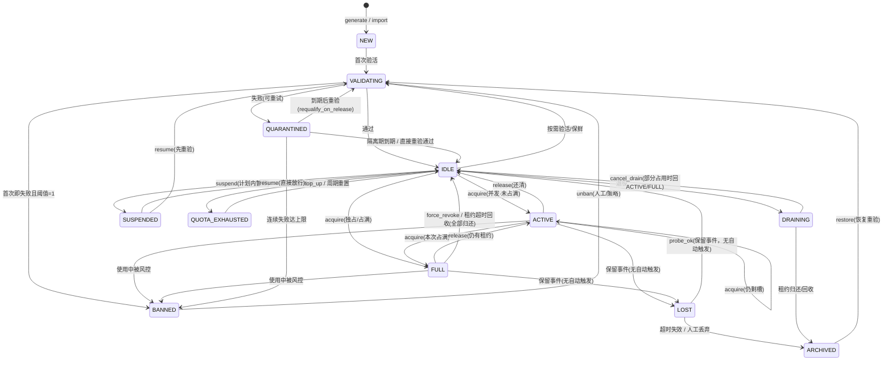

# 状态机

12 个状态。`core/state.py` 的 `TRANSITIONS` 是**状态机事件**的可执行定义，本页的表格与图是对它的整理；但并非所有写路径都经过状态机——`drain`、到期、强制撤销归档、封禁等操作直接写状态，完整行为以代码为准。

## 状态图



## 状态语义

| 状态 | 可否分配 | 说明 |
| --- | --- | --- |
| `NEW` | 否 | 刚生成/导入，未验活；不会自动推进 |
| `VALIDATING` | 否 | 验活进行中 |
| `IDLE` | 是 | 无租约、可用（独占资源的空闲态） |
| `ACTIVE` | 是（剩槽） | 部分占用但仍有可用槽（仅并发资源） |
| `FULL` | 否 | 占用满（独占资源的占用态） |
| `QUARANTINED` | 否 | 隔离期，到期自动恢复 |
| `SUSPENDED` | 否 | 计划内暂停/维护，人工恢复 |
| `QUOTA_EXHAUSTED` | 否 | 配额耗尽，`top_up` 或周期重置恢复 |
| `BANNED` | 否 | 封禁，需显式 `unban` 或策略解封 |
| `LOST` | 否 | 保留的失联状态。当前公共 API 没有自动进入路径（`lease_lost` 只回收槽位）；维护任务会归档已处于 `LOST` 的资源 |
| `DRAINING` | 否 | 退役中，等租约归还后归档；`cancel_drain` 可回到 IDLE/ACTIVE/FULL |
| `ARCHIVED` | 否 | 归档终态（软删除），保留审计、可 `restore` |

## 转移表

| 当前状态 | 事件 | 目标状态 | 守卫条件 |
| --- | --- | --- | --- |
| NEW | `validate_ok` | IDLE | 首次验活通过 |
| NEW | `validate_fail` | QUARANTINED / BANNED | 按失败策略 |
| VALIDATING | `validate_ok` | IDLE | — |
| VALIDATING | `validate_fail` | QUARANTINED | `fail_count < max` |
| VALIDATING | `validate_fail` | BANNED | `fail_count >= max` |
| IDLE | `acquire` | ACTIVE / FULL | `used+slots < max` → ACTIVE；`== max` → FULL |
| ACTIVE | `acquire` | ACTIVE / FULL | 并发资源可叠加租约 |
| IDLE / ACTIVE | `validate_ok` | 原状态 | 保鲜刷新健康分 |
| IDLE / ACTIVE | `validate_fail` | QUARANTINED | — |
| IDLE | `suspend` | SUSPENDED | 计划内暂停 |
| IDLE | `quota_exhausted` | QUOTA_EXHAUSTED | 配额用尽 |
| ACTIVE / FULL | `release` | IDLE / ACTIVE | token 匹配，按剩余槽回退 |
| ACTIVE / FULL | `lease_expired` | IDLE / ACTIVE | reaper（租约回收器） |
| ACTIVE / FULL | `force_revoke` | IDLE / ACTIVE | 管理员强制撤销（带原因 + 审计） |
| ACTIVE / FULL | `lost` | LOST | — |
| ACTIVE / FULL | `banned` | BANNED | — |
| QUARANTINED | `quarantine_expired` | IDLE | 隔离期到；`requalify_on_release=true` 时转 VALIDATING |
| QUARANTINED | `validate_ok` | IDLE | 直接重验通过 |
| QUARANTINED | `validate_fail` | BANNED | 累计失败达上限 |
| SUSPENDED | `resume` | IDLE / VALIDATING | 可选先重验 |
| QUOTA_EXHAUSTED | `top_up` / `quota_reset` | IDLE / VALIDATING | 手动或周期重置 |
| BANNED | `unban` | VALIDATING | 解封后先验活再放行 |
| LOST | `probe_ok` | IDLE | 保留事件；当前代码没有自动触发点 |
| LOST | `discard` / `lost_gc` | ARCHIVED | 超时失效 |
| IDLE / ACTIVE / FULL | `drain` | DRAINING | 停止新分配；实现为直接写状态，不经状态机 |
| DRAINING | `undrain` | IDLE / ACTIVE / FULL | 按剩余占用决定 |
| DRAINING | `release` / `reaped` | ARCHIVED | 归档终态 |
| ARCHIVED | `restore` | VALIDATING | 恢复后重验 |
| 任意状态 | `admin_set_state` | IDLE / SUSPENDED / QUOTA_EXHAUSTED / VALIDATING / ARCHIVED | 仅人工，需 `reason` + `operator` + 审计；不能直接设为 NEW / LOST / DRAINING / BANNED |

## 生命周期总览

```text
生成/导入(NEW)
   │ 首次验活
   ▼
  VALIDATING ──失败──> QUARANTINED ──超阈值──> BANNED
   │ 通过                                    │ unban(先重验)
   ▼                                         ▼
  IDLE ──acquire──> ACTIVE/FULL ──release/revoke──> IDLE
   │                                       │
   │ 保鲜验活失败                            │ 保留状态（无自动入口）
   ▼                                       ▼
  QUARANTINED <──── 验活失败            LOST ──> IDLE / ARCHIVED

  IDLE ──suspend──> SUSPENDED ──resume──> IDLE / VALIDATING
  IDLE ──配额耗尽──> QUOTA_EXHAUSTED ──top_up/重置──> IDLE
  IDLE/ACTIVE/FULL ──drain──> DRAINING ──租约归还──> ARCHIVED ──restore──> VALIDATING
```
